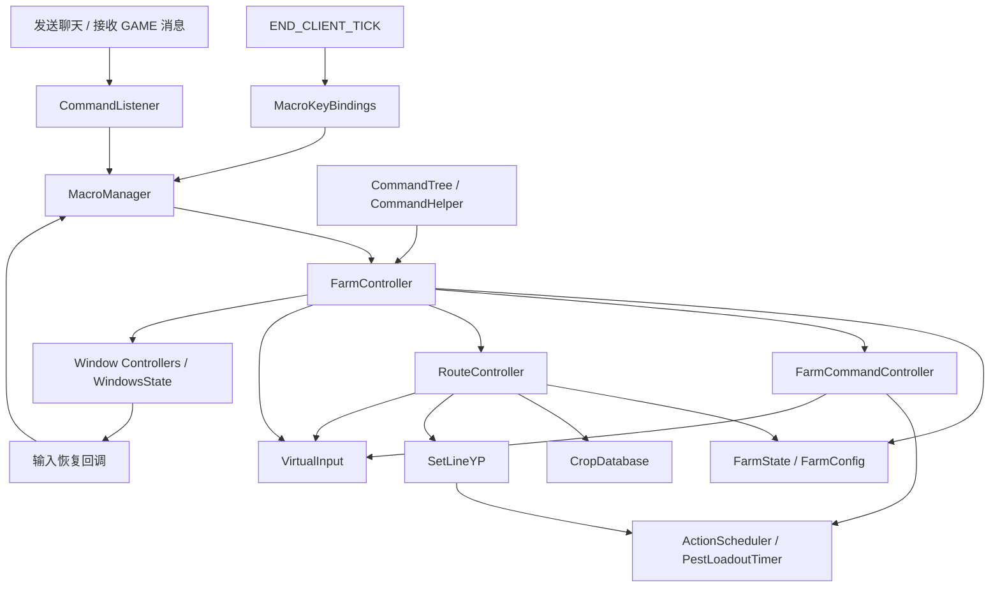

# Ultimate Garden 项目代码结构与行为总结

## ESP 与 Silverfish 可视化（当前实现）

```text
client/config/ESPConfig.java
client/macro/esp/
├── ESPManager.java
├── ESPRenderer.java
├── ESPTarget.java
├── render/
│   ├── ESPBoxRenderer.java
│   ├── ESPFillRenderer.java
│   └── ESPTracerRenderer.java
└── style/
    ├── ESPStyle.java
    ├── ESPColorMode.java
    └── ESPColorProvider.java
client/macro/farm/pest/PestESP.java
tests/esp/ESPRegression.java
tests/esp/run.ps1
```

`Ultimate_GardenClient` 创建唯一 ESPManager，注册 `PestESP::collect` 后注册一次 Fabric `LevelRenderEvents.END_EXTRACTION` 与 `END_MAIN`。新增 ESP 模块只需注册目标提取回调，不复制绘制代码。ESP 不依赖农业宏 running、菜单暂停或害虫装备计时器。

PestESP 只在 `pestESPEnabled` 为 true 时遍历当前 ClientLevel 的 `entitiesForRendering()`；26.1.2 该接口返回客户端实体集合，不做摄像机视锥筛选。严格使用 `EntityType.SILVERFISH`，排除死亡/移除实体；使用 `getPosition(partialTick)` 平移实际 AABB 获得插值边界框。没有实体名称匹配、额外区块请求、追踪范围修改、网络消息、输入或实体写操作。

提取阶段在 LevelRenderState 的 Fabric RenderStateDataKey 中保存当前帧不可变目标、颜色配置与连续时间快照；绘制阶段不读取实体或配置。没有跨世界实体引用缓存，每次提取完整替换快照，断线令旧代快照失效，退出释放自有 ByteBufferBuilder。GPU 上传和资源由原生 RenderType 管理，不增加 LevelRenderer Mixin。

ESPRenderer 使用隔离的 RenderPipeline/RenderSetup。Box 的 12 条边与 Tracer 使用当前原生 LINES 管线及逐顶点 LineWidth，合法宽度为 0.5..16 帧缓冲像素；颜色片元着色器不应用雾衰减。Fill 使用排序的 QUADS、双面六面填充及透明混合。所有深度模式均不写深度；throughWalls=true 关闭深度测试，否则遵守场景深度。彩虹由同一 ESPColorProvider 计算，基于单调连续时间和世界坐标逐顶点变色。

Tracer 使用当前相机投影矩阵和实际绘制 ModelView 矩阵，把目标中心投影至 NDC，再反投影到安全的相机平面上绘制原生粗线；起点为视口中心。该辅助线始终置顶，不宣称墙体遮挡。后方/无效投影跳过，屏幕外端点截到视口边缘，中心重合不产生退化线。平面深度 0.5 兼容 OpenGL 与 zero-to-one 深度范围。

ConfigManager 新增 `Module.ESP` / `getESPConfig()`，沿用 FabricLoader 实例配置目录与 ConfigIO 原子保存。`esp.json` 保存 schemaVersion、throughWalls、box/fill/tracer 各自的 enabled/colorMode/color/alpha、box/tracer 的 lineWidth，以及 rainbow.cycleDurationMs。非法字段逐项回退、备份原文，保留其他合法字段和未知字段，高版本文件禁止覆盖。PestConfig 仅新增 `pestESPEnabled=false`，autoPestLoadout 与 2500 tick 默认计时逻辑不变。

GUI 的 Pests 页提供独立 Pest ESP 开关；Settings 提供共享 Box/Fill/Tracer 设置。合法输入即时应用并保存，非法草稿保留最后合法值；RAINBOW 模式禁用单色输入。界面不自行读写 JSON。`tests/esp/run.ps1` 使用已有 runtimeClasspath 检查持久化、颜色、几何生成与投影；GPU 外观、实体识别及不同图形设备表现仍需游戏内测试。

## 原生 GUI 与菜单生命周期（当前实现，以本节为准）

### 入口与界面

新增 `client/ui/MenuController.java` 作为统一打开入口，供 M 原生 KeyMapping 与 `/ultimategarden menu` 复用。只在有效游戏上下文打开；快捷键不抢占其他 Screen 的输入，菜单内文本编辑焦点下 M 不关闭。Screen 的正常移除统一通知农业菜单会话；ESC 的选择弹层取消不会移除整个菜单，关闭按钮和非编辑状态的 M 直接关闭菜单。

```text
client/ui/
├── MenuController.java
├── screen/UltimateGardenScreen.java
├── theme/ThemePalette.java
├── render/RoundedRect.java
└── widget/
    ├── StyledButton.java
    ├── ToggleSwitch.java
    └── DropdownSelector.java
```

使用本项目 Minecraft 26.1.2 实际的 `GuiGraphicsExtractor` / `extractRenderState` API；原生 EditBox 处理文字输入，统一控件提供圆角、禁用、选中、悬停、提示与键盘操作。内容可滚动、选择器使用同一 Screen 内的选择层，小尺寸导航间距自适应。字段编辑草稿只用于未提交表单，不是另一份有效业务配置；页面切换保留草稿。

视觉参考已查阅 LocalSend 官方 [theme.dart](https://github.com/localsend/localsend/blob/main/app/lib/config/theme.dart)，采用其 Material 3、teal 种子色和填充式控件思路，结合 Minecraft 原生字体与渲染，不宣称像素级复刻，也不使用 LocalSend 商标。LIGHT/DARK 与强调色实时取自 UIConfig；SYSTEM 明确回退 LIGHT。

| 页面 | 数据与控制入口 |
| --- | --- |
| Home | FarmState、FarmController.getRunStatus、实际作物/模式/方向、路线计数/进度、真实 Pest 计时与待处理状态；Start 记录关闭后的明确意图，Pause/Reset 复用原控制入口 |
| Farm | 三个 FarmConfig 选择；CropConfig 的高级参数表单；Previous/Next Line、Set Spawn、Warp Garden、Loadout 进入关闭后待执行的控制操作队列 |
| Pests | PestConfig 两个字段，真实剩余 tick/20TPS 秒数；手动启动和取消仍走 FarmCommandController，自动开关不限制手动计时 |
| Hotkeys | MacroKeyBindings.getBindings 返回全部 12 个实际 KeyMapping；键位变更仍由 Minecraft 原生 Controls 管理 |
| Settings | showModChatHints、autoResumeFarmAfterGuiClose、uiThemeMode、accentColor，通过 ConfigManager 保存；不直接读写 JSON |

涉及路线的编辑仅在用户已暂停/重置、无动作队列、无待执行菜单操作、无活动害虫计时器时允许；改变作物选择后明确重置路线上下文。CropConfig.updateCrop 在整条定义验证成功后再提交，不接受 CUSTOM；高级 Hint 空值表示删除可选覆盖并使用运行角度回退，默认 JSON 本身没有改动。

### 菜单暂停与恢复

新增 `macro/GuiPauseState.java` 保存临时菜单状态与用户意图，由 FarmController 持有。它不存入 JSON，也不重复实现农业算法。菜单打开时通过 beginMenuPause 暂停运行、冻结队列、禁用物理输入拦截以便 GUI 操作，并释放模拟输入；不调用原 pauseMacro，不清行数、方向或路线 tick。

VirtualInput 新增动作输入所有权和 HeldActions 快照。FarmCommandController 与 SetLineYP 的持续输入被标记为动作输入；路线输入不在关闭后队列恢复阶段重放。快照只恢复尚在执行队列需要的持续输入，完成后统一释放，再按原 startMacro 入口恢复路线。

| 职责 | 菜单打开时 | 关闭后 |
| --- | --- | --- |
| 路线 tick / 换行推进 | 冻结，保留 FarmState 上下文 | 仅在恢复条件满足后继续 |
| 农业 ActionScheduler | setPaused(true)，保留 current、FIFO 队列与剩余延迟 | 原位置继续倒计时，不重放已完成动作 |
| PestLoadoutTimer | 继续真实倒计时，到期事件只消费一次并标记 pending | 原队列空闲后执行到期装备流程 |
| 菜单请求的农业操作 | 只记录现有控制器操作，不发包、不模拟输入 | 在既有业务动作之后逐个调用原接口 |
| 旧 VirtualMouse 独立队列 | 没有新增或删除其驱动，原未接入状态保留 | 不与农业队列合并 |

关闭处理在后续客户端 tick 确认 Screen 已关闭后开始；恢复原窗口光标模式，并保持菜单会话为 draining。原队列先执行，到期 Pest 流程在队列空闲后进入同一动作调度器，菜单操作最后分发；全部工作结束后才判断路线恢复。业务 loadout 允许操作预期的容器界面；无关 Screen/overlay 会继续阻止游戏动作。没有用硬编码等待时间模拟完成。

GeneralConfig 新增 `autoResumeFarmAfterGuiClose=false`，ConfigManager 字段级加载、保存、异常和高版本保护沿用现有机制。菜单开关立即保存，关闭时读取最新值。false 仍允许业务动作完成，但路线保持暂停；true 只恢复打开前的运行意图（包含原装备流程的业务暂停上下文）。打开前已停止/手动暂停不会自启。菜单内 Start 明确请求关闭后启动，Pause/Reset 取消自动恢复资格；失败、超时或取消待处理业务动作均阻止无条件恢复。

菜单内的 Pause/Reset 保留原取消语义；Reset 才清路线。害虫倒计时不会被普通 GUI 暂停取消。菜单正常关闭不会取消队列；断线、世界身份变化和客户端退出会中止失效动作、取消计时、释放全部输入并丢弃无效路线进度，恢复配置选择到停止状态。原有唯一 END_CLIENT_TICK 注册点保留，没有重复 tick 或重复菜单事件注册。

### 变动与验证

除新增 UI 类和 GuiPauseState 外，本轮修改 GeneralConfig/ConfigManager、CropConfig、FarmController、FarmCommandController、PestLoadoutTimer、ActionScheduler、VirtualInput/VirtualKeyboard、SetLineYP、RouteController、WindowsFocusController、MacroKeyBindings、CommandTree、Ultimate_GardenClient 与 en_us 语言资源。增加了 tests/gui 独立回归及边界桩，扩展 tests/config；桩只在独立测试类路径，不进入生产 JAR。

Java 25 下 `gradlew.bat build` 通过；`tests/gui/run.ps1` 通过 30 项意图/调度测试与 13 项实际 FarmCommandController/PestLoadoutTimer 边界测试；`tests/config/run.ps1` 通过 115 项配置检查。包含 2500 个冻结 tick、残余延迟、FIFO、开关往返、一次性恢复、明确用户操作优先、延迟事件、手动计时、取消、断线清理、配置持久化和非法作物编辑不提交。

已启动开发客户端，并在新建 `UG GUI QA` 世界观察到原生菜单及高级参数界面；未进入此前存档。检测到用户输入后停止继续自动控制窗口。最后的小尺寸布局、关闭命中区域等修正通过编译与静态检查，未重新进行完整视觉测试。独立测试不验证原生渲染、实际网络包或服务器 GUI。仍需实机验证全部关闭方式、M 重绑定/文本焦点、两种主题和 GUI Scale、真实农业路线暂停/恢复、服务器 loadout/warp/spawn、超时/取消与断线组合场景。

以下章节是此前任务的历史说明，涉及“没有 UI”、旧菜单命令状态或菜单生命周期的描述，以本节为准。

## 独立作物与编号更新（当前实现，以本节为准）

- CropType 只有十五个独立值：1 WHEAT，2 FLOWER，3 COCOA，4 MELON，5 PUMPKIN，6 SUGARCANE，7 MUSHROOM，8 CACTUS，9 CARROT，10 POTATO，11 NETHER_WART，12 TIMETESTER，13 CUSTOM1，14 CUSTOM2，15 CUSTOM3。0 仅为未选；不保留旧编号或组合枚举别名。
- default-crops.json 已拆成十五个独立节点。胡萝卜/马铃薯、小麦/地狱疣、西瓜/南瓜分别深复制原组合参数；默认 tickLimit、行数、移动、运行角度及 alternateSlot 不变。CARROT/POTATO 的 hintPitch 为 +3，运行 Pitch 仍 -3；WHEAT/NETHER_WART 提示及运行均 -3。
- CropConfig 的旧组合字符串仅用于数据迁移，不参与业务枚举。迁移先复制旧节点，再以已有新节点字段覆盖，删除旧节点；保存前 ConfigManager 备份原文件，备份失败禁写。保留合法自定义参数和自定义名称，旧默认组合名称换成独立名称。
- FarmConfig 不接受旧组合名称，回退 selectedCropType=NONE、selectedSimulatedCropType=WHEAT 并备份。无版本信息的旧 cropType/simulateCropType 数字不再解释为任何选择别名，要求重新选择；模式 0/1 转换不变。稳定独立名称如 FLOWER、MUSHROOM、TIMETESTER 继续有效。
- FarmController 的蘑菇出生点分支与 RouteController 的仙人掌换行分支使用明确枚举；TimeTester 使用 TIMETESTER 枚举，模拟目标仅接受 1～11。CUSTOM 即使 enabled=true 也不可启动，聊天选择时明确显示未实现。
- FarmHints 按枚举顺序显示“数字. 名称”，Program 与 A/B 角度使用当前独立节点，角度两位小数。不再输出旧映射或组合兼容说明。没有修改 UI、输入、服务器命令、害虫计时或路线算法。
- Java 25 下构建通过；独立配置回归通过 109 项，覆盖完整编号、模拟目标范围、CUSTOM 拒绝执行、旧选择安全回退、组合参数复制、新节点优先与原文件备份。尚未验证游戏内初始化、TimeTester、特殊换行和实际提示输出。

以下为此前阶段的历史记录；旧编号、组合节点和兼容提示描述均已被本节取代。

## 配置命名与业务接线更新（2026-11-07，以本节为准）

- 继续使用唯一 ConfigManager。开发实例 `run/config/ultimategarden` 检查时未发现现有配置文件；本次只在隔离临时目录执行文件测试，没有覆盖真实实例文件。
- FarmConfig 的持久化字段为 selectedCropType（字符串，NONE 表示原 ID 0）、selectedFarmMode（FARM/PESTS）、selectedSimulatedCropType（TimeTester 模拟作物字符串）。旧 cropType/mode/simulateCropType 数字分别转换，原 1～8、9 和模式 0/1 语义保留；数字只通过显式 ID 适配方法进入 FarmState，不改变其运行状态字段。
- UIConfig 的 theme 改名为 uiThemeMode，accentColor 不变。优先使用合法新字段，非法或缺失时尝试合法旧字段，再采用该字段默认值；坏字段先备份原文件，不重置其他合法字段。迁移成功保存新名称，移除已知旧名称，未知字段仍保留。未来 schema 文件仍禁止降级覆盖。
- 新增 config/PestConfig 与 pest.json：autoPestLoadout 默认 true，仅在 FarmController.automateTaskByMonitorMessage 的事件入队及延迟回调处检查。手动热键调用 FarmCommandController.startPestLoadoutTimer 不检查该开关。已开始的倒计时不会因关闭事件开关而被取消，已排队但尚未启动的事件会再次检查开关。
- pestLoadoutDelayTicks 默认 2500，要求正整数；FarmCommandController 在启动倒计时时将其传给 PestLoadoutTimer.start(int)，捕获本次时长。运行中修改不会重置当前计时；重复 start 的原有不重置行为、暂停/reset 不取消计时行为均保留。
- GeneralConfig 新增 showModChatHints 默认 true。HintManager.print/printNull 控制普通提示与空行；命令错误使用 printRequired 绕过普通提示开关，故障日志不受影响。关闭普通提示也会隐藏初始化说明，但不影响输入处理。
- 未添加 interceptPhysicalInputWhileMacroRunning：实体按键的释放事件和原生 KeyMapping 可能覆盖虚拟按住状态，当前没有安全的双来源输入仲裁。保留始终启用的既有拦截策略。没有添加未来三个农业路线开关。
- 农业配置在控制器构造时复制合法选择到新 FarmState，或在停止状态的聊天初始化完成后应用并保存。直接修改配置对象不会切换运行中的路线；运行中设置变更用于下一次控制器初始化/完整选择流程。Pest 事件开关对后续触发生效、延迟对下一次计时生效、普通提示开关对下一次输出生效。UI 尚无实际界面，主题配置提供统一访问接口，不另存副本。
- 本次修改 ConfigManager、FarmConfig、GeneralConfig、UIConfig、FarmController、FarmCommandController、PestLoadoutTimer、HintManager，新增 PestConfig，更新独立配置测试与本文。未修改 crops.json 默认资源、角度、路线算法、热键或输入逻辑。
- Java 25 下 gradlew.bat build 成功，独立配置测试通过 66 项；新增验证旧数字迁移、新字段优先级、单字段恢复、主题改名、Pest/General 参数保存。独立测试未启动 Minecraft，也未验证实际消息、按键、GUI、倒计时与聊天显示；这些仍需实机测试。

最终默认字段：

```json
{
  "farm.json": {"schemaVersion": 1, "selectedCropType": "NONE", "selectedFarmMode": "FARM", "selectedSimulatedCropType": "CARROT_POTATO"},
  "pest.json": {"schemaVersion": 1, "autoPestLoadout": true, "pestLoadoutDelayTicks": 2500},
  "general.json": {"schemaVersion": 1, "showModChatHints": true},
  "ui.json": {"schemaVersion": 1, "uiThemeMode": "SYSTEM", "accentColor": "#1B978C"}
}
```

以下章节记录此前迁移的历史状态；字段命名和当前行为以本节为准。

## 作物数据库迁移更新（2026-11-07，以本节为当前实现）

- 沿用现有 ConfigManager/ConfigIO，新增 CROPS 模块、getCropConfig()，默认在实例 config/ultimategarden/crops.json 存储。默认值唯一来源是 `src/client/resources/ultimategarden/default-crops.json`；JAR 中该资源只用于首次生成、缺失字段及损坏恢复，业务只消费内存中加载的有效 JSON。
- FarmConfig 已从 macro/farm 移至 client/config。新增 config/CropConfig、CropDefinition；旧 CropData 迁入 config，作为未接入的兼容 DTO，无静态参数。RouteData 是运行时适配对象，RouteKey 是业务键枚举，继续保留。
- CropDatabase 仅保留查询适配 API，不再含硬编码参数表；未接入的 RouteDatabase 保留 API，由同一 CropConfig 构造 RouteData，不再维护 EnumMap 参数表。活动 RouteController 直接注入 CropConfig。
- 数字兼容：1→CARROT_POTATO（旧合并选择的运行参数全部保留），2→FLOWER，3→COCOA，4→MELON_PUMPKIN，5→SUGARCANE，6→MUSHROOM，7→CACTUS，8→TIMETESTER；9→WHEAT_NETHER_WART。旧枚举合并名称保留为指向 CARROT_POTATO 的源代码别名，不创建第十三个定义。
- CUSTOM1/2/3 的内部编号为 101/102/103，列表显示 Coming soon；即使用户设 enabled=true 也不可执行。FarmConfig 拒绝保存 CUSTOM 选择，聊天选择拒绝 CUSTOM，startMacro 也检查执行资格。TimeTester 的模拟作物支持旧 1～7 及新 9，不接受 8 或 CUSTOM。
- 原 ID 1 的 CropDatabase 运行 Pitch=-3，而旧提示对胡萝卜/马铃薯显示 +3。迁移后 CARROT_POTATO 的 pitchA/B 仍为 -3，hintPitchA/B 为 +3；WHEAT_NETHER_WART 运行及提示均为 -3。没有按照示例把运行角度改成 +3。
- FarmHints 动态读取名称、A/B 两组运行及提示角度，Locale.ROOT 格式化两位小数；ID 1 还动态展示拆分两类的提示 Pitch，说明旧合并语义。提示层不直接读文件。Inventory 文案是既有物品操作约定，未为其增加配置字段。
- alternateSlot 从 RouteDatabase 的甘蔗/蘑菇属性迁入 JSON，RouteController 消费该字段；TimeTester 的长路线时间从 TIMETESTER.tickLimit 获取。除这些数据读取位置外，换行顺序、随机附加时间、攻击移动、服务器命令、害虫计时和键位保持原实现。Yaw/Pitch 仍然是数据/提示，旧逻辑依赖物品切换，没有新增直接旋转玩家的动作。
- 加载时补齐缺少的作物/字段，保留合法值和未知字段。移动只接受不重复 W/S/A/D，非空；行时间/行数为正整数；角度必须有限且 yaw 在 ±180、pitch 在 ±90 范围；CUSTOM 可不含路线。单条坏作物恢复该条默认，其他合法修改保留，先备份原文件再保存；备份失败禁写。高 schemaVersion 保护继续生效。
- 没有热重载系统；编辑 crops.json 后重启生效。不在 tick 或提示时读写文件。未来统一重载入口可调用 CropConfig.load（只更新内存），文件生命周期仍须由 ConfigManager 管理。
- 构建：Java 25 下 gradlew.bat build 成功。独立配置回归通过 51 项，新增覆盖 12 标识、运行/展示差异、CUSTOM 禁用、用户参数重载、缺失定义补齐、坏移动恢复与合法修改保留。游戏内路线、旧 ID 1 兼容提示、9 的选择、TimeTester 和 GUI 尚待实机测试。

当前主要配置目录：

```text
client/config/
├── ConfigManager.java
├── ConfigIO.java
├── GeneralConfig.java
├── UIConfig.java
├── FarmConfig.java
├── CropConfig.java
├── CropDefinition.java
└── CropData.java
```

完整默认 crops.json（与生成资源相同）：

```json
{
  "schemaVersion": 1,
  "crops": {
    "CARROT_POTATO": {
      "name": "Carrot/Potato",
      "enabled": true,
      "tickLimit": 806,
      "totalLines": 15,
      "movementA": [
        "W",
        "D"
      ],
      "movementB": [
        "W",
        "A"
      ],
      "yawA": -90.0,
      "pitchA": -3.0,
      "yawB": -90.0,
      "pitchB": -3.0,
      "alternateSlot": false,
      "hintPitchA": 3.0,
      "hintPitchB": 3.0
    },
    "FLOWER": {
      "name": "Flower",
      "enabled": true,
      "tickLimit": 544,
      "totalLines": 16,
      "movementA": [
        "W",
        "A"
      ],
      "movementB": [
        "W",
        "D"
      ],
      "yawA": 90.0,
      "pitchA": -3.0,
      "yawB": 90.0,
      "pitchB": -3.0,
      "alternateSlot": false
    },
    "COCOA": {
      "name": "Cocoa",
      "enabled": true,
      "tickLimit": 797,
      "totalLines": 45,
      "movementA": [
        "W",
        "D"
      ],
      "movementB": [
        "S",
        "D"
      ],
      "yawA": 0.0,
      "pitchA": -45.0,
      "yawB": 0.0,
      "pitchB": -45.0,
      "alternateSlot": false
    },
    "MELON_PUMPKIN": {
      "name": "Melon/Pumpkin",
      "enabled": true,
      "tickLimit": 560,
      "totalLines": 23,
      "movementA": [
        "W",
        "A"
      ],
      "movementB": [
        "W",
        "D"
      ],
      "yawA": 90.0,
      "pitchA": -61.0,
      "yawB": 90.0,
      "pitchB": -61.0,
      "alternateSlot": false
    },
    "SUGARCANE": {
      "name": "SugarCane",
      "enabled": true,
      "tickLimit": 475,
      "totalLines": 30,
      "movementA": [
        "W"
      ],
      "movementB": [
        "W"
      ],
      "yawA": 45.0,
      "pitchA": -3.0,
      "yawB": 135.0,
      "pitchB": -3.0,
      "alternateSlot": true
    },
    "MUSHROOM": {
      "name": "Mushroom",
      "enabled": true,
      "tickLimit": 800,
      "totalLines": 15,
      "movementA": [
        "W"
      ],
      "movementB": [
        "W"
      ],
      "yawA": -65.0,
      "pitchA": -3.0,
      "yawB": -115.0,
      "pitchB": -3.0,
      "alternateSlot": true
    },
    "CACTUS": {
      "name": "Cactus",
      "enabled": true,
      "tickLimit": 272,
      "totalLines": 30,
      "movementA": [
        "D"
      ],
      "movementB": [
        "A"
      ],
      "yawA": -90.0,
      "pitchA": 0.0,
      "yawB": -90.0,
      "pitchB": 0.0,
      "alternateSlot": false
    },
    "TIMETESTER": {
      "name": "TimeTester",
      "enabled": true,
      "tickLimit": 99999,
      "totalLines": 99999,
      "movementA": [
        "W",
        "A"
      ],
      "movementB": [
        "W",
        "D"
      ],
      "yawA": 66.66,
      "pitchA": 66.66,
      "yawB": 66.66,
      "pitchB": 66.66,
      "alternateSlot": false
    },
    "WHEAT_NETHER_WART": {
      "name": "Wheat/NetherWart",
      "enabled": true,
      "tickLimit": 806,
      "totalLines": 15,
      "movementA": [
        "W",
        "D"
      ],
      "movementB": [
        "W",
        "A"
      ],
      "yawA": -90.0,
      "pitchA": -3.0,
      "yawB": -90.0,
      "pitchB": -3.0,
      "alternateSlot": false,
      "hintPitchA": -3.0,
      "hintPitchB": -3.0
    },
    "CUSTOM1": {
      "name": "CUSTOM1",
      "enabled": false
    },
    "CUSTOM2": {
      "name": "CUSTOM2",
      "enabled": false
    },
    "CUSTOM3": {
      "name": "CUSTOM3",
      "enabled": false
    }
  }
}
```

以下章节包含前轮架构和配置任务的历史记录；若类路径、静态数据库或持久化描述冲突，以本节为准。


## 配置系统更新（2026-11-07，以本节为准）

- 当前业务源码新增四个配置类：`client/config/ConfigManager`、`ConfigIO`、`GeneralConfig`、`UIConfig`，复用 `macro/farm/FarmConfig`；业务源码共 48 个 Java 文件。历史迁移表仍记录上次架构重构。
- 客户端入口先创建唯一 ConfigManager，加载完毕后注入 FarmController；控制器引用管理器的同一 FarmConfig，不再自行 new 或调用空 load/save。
- 路径为 `FabricLoader.getInstance().getConfigDir().resolve("ultimategarden")`；文件为 general.json、farm.json、ui.json。版本均为 schemaVersion=1；未知字段保留，缺失字段采用默认。
- general 仅有版本；farm 保存 cropType（默认 0，未选）、mode（默认 0 Farm，1 Pests）、simulateCropType（默认 1，用于重启恢复 TimeTester 模拟作物）；ui 为 SYSTEM/LIGHT/DARK 主题与默认 #1B978C 强调色。
- 完成整个合法聊天选择后才提交并保存；TimeTester 等模拟作物选完才保存。半完成输入不更新持久化对象。重启仅恢复选择，不启动宏、不恢复进度、按键、队列、等待标记或计时器。
- ConfigIO 使用已有 Gson 严格解析，同目录临时写入后优先原子替换；不支持时回退替换。失败记录原有 LOGGER。坏文件先复制 `.broken-时间戳-UUID` 备份；备份失败不覆盖。读取失败使用内存默认并禁写。高版本文件警告并禁写，包含 reset/saveAll。
- ConfigManager 提供三个 getter、save(Module)、saveAll、reset(Module)、saveFarmConfig、saveUIConfig。reset 保留对象身份，不操纵运行中的宏；直接 API 修改需显式保存，农业运行时选择在构造或聊天完成流程应用。
- UI 尚未实现，只有配置数据与接口，不新增 ThemeManager。KeyMapping 继续由 options.txt 管理，不创建 hotkeys.json。未修改路线、动作、计时和输入算法。
- Java 25 下 `.\gradlew.bat build` 成功；独立 `tests/config/ConfigRegression.java` 通过 38 项隔离文件检查。设置 JAVA_HOME 后可运行 `tests/config/run.ps1`。覆盖默认生成、重载、TimeTester、主题、删除恢复、缺失/未知字段、损坏备份、非法 ID/类型、高版本保护、写失败；独立测试没有日志 provider，未捕获日志输出。游戏聊天、热键、GUI 仍待实机验证。

更新时间：2026-11-06（架构重构后）。用途：后续开发前的阅读入口，源码变化后应同步维护本文。

本次完整复核项目源码并实施目录迁移、类重命名、路线职责提取与管理器接线。最终共 **44 个 Java 源文件**：客户端 42 个，公共源集 2 个。所有农业自动化实现集中到 `client/macro/farm/`；公共源集、资源、构建配置与版本保持不变。未创建无用途的 `ui/` 空目录，未来新增 UI 时直接放在 `client/ui/`。

本文记录最终代码的静态结构与既有行为。Java 构建及自动化对照检查已通过，未启动 Minecraft 验证交互。后续任务应先读本文，再读取实际要修改的源码，不能把快照当作永久事实。`.git`、IDE 数据、构建缓存、运行日志及第三方二进制不属于业务源码范围。

## 1. 项目定位与构建

Fabric Minecraft 客户端花园农业自动化 Mod，支持作物路线、持续攻击与移动、换行、传送、出生点设置、害虫模式装备切换和鼠标释放。源码注释保留 C++ 输入迁移背景，但仓库内没有原 C++ 代码。

| 项目项 | 当前配置（本次未修改） |
| --- | --- |
| Mod ID / Gradle 项目名 | `ultimate_garden` |
| 根包 | `com.kuangsanfeng.ultimategarden` |
| Mod 版本 / group | `1.0.1` / `com.kuangsanfeng.ultimategarden` |
| Minecraft / Java | `26.1.2` / Java 25 |
| Fabric Loader / API | `0.19.3` / `0.155.2+26.1.2` |
| Loom 配置 / Wrapper | `1.17-SNAPSHOT` / Gradle `9.5.1` |
| 源码划分 | `src/main` 公共入口；`src/client` 客户端，Loom splitEnvironmentSourceSets |
| 许可证 | CC0-1.0 |

`build.gradle` 设置 Java release/source/target 25、sources JAR、版本资源展开及 maven-publish（没有发布仓库）。Gradle 最大堆 1G、并行构建、关闭 configuration cache。Fabric 元数据和 README 仍有模板文案。`fabric.mod.json` environment 为 `*`，客户端 Mixin 单独限于 client。

Windows 构建命令：`./gradlew.bat build`。当前 shell 默认 Java 是 17；本次构建临时指定 IntelliJ 配置的 `C:/Users/Zhou/.jdks/ms-25.0.4.1` 为 JAVA_HOME，没有修改项目 JDK 配置。CI 仍在 Ubuntu 24.04 / Microsoft JDK 25 下构建并上传 `build/libs/`。未引入第三方依赖或新的测试框架。

## 2. 最终源码结构与类索引

以下树由最终文件系统生成，相对于 `src/client/java/com/kuangsanfeng/ultimategarden/`：

```text
client/
├── command/
│   ├── CommandHelper.java
│   ├── CommandListener.java
│   └── CommandTree.java
├── hint/
│   ├── HintManager.java
│   └── KeyNameMap.java
├── hotkey/
│   └── MacroKeyBindings.java
├── input/
│   ├── VirtualInput.java
│   ├── VirtualKeyboard.java
│   └── VirtualMouse.java
├── macro/
│   ├── farm/
│   │   ├── action/
│   │   │   ├── FarmCommandController.java
│   │   │   └── FarmCommandInput.java
│   │   ├── crop/
│   │   │   ├── CropData.java
│   │   │   ├── CropDatabase.java
│   │   │   └── CropType.java
│   │   ├── hint/
│   │   │   └── FarmHints.java
│   │   ├── pest/
│   │   │   └── PestLoadoutTimer.java
│   │   ├── route/
│   │   │   ├── RouteController.java
│   │   │   ├── RouteData.java
│   │   │   ├── RouteDatabase.java
│   │   │   ├── RouteKey.java
│   │   │   ├── SetLineYP.java
│   │   │   └── SlotSelector.java
│   │   ├── FarmConfig.java
│   │   ├── FarmController.java
│   │   ├── FarmState.java
│   │   └── MacroConstants.java
│   └── MacroManager.java
├── mixin/
│   ├── ExampleClientMixin.java
│   ├── KeyMappingAccessor.java
│   ├── KeyboardHandlerAccessor.java
│   ├── WindowsFocusMixin.java
│   ├── WindowsInputMixin.java
│   ├── WindowsMissTimeMixin.java
│   ├── WindowsMouseMixin.java
│   └── WindowsPauseMixin.java
├── scheduler/
│   ├── ActionScheduler.java
│   └── InputScheduler.java
├── window/
│   ├── WindowsFocusController.java
│   ├── WindowsInputInterceptor.java
│   ├── WindowsNativeBridge.java
│   └── WindowsState.java
└── Ultimate_GardenClient.java
```

| 模块 | 类与职责 |
| --- | --- |
| 公共源集 | `Ultimate_Garden`：MOD_ID/LOGGER/Identifier 与日志初始化；`mixin.ExampleMixin`：loadLevel 空模板注入 |
| 客户端入口 | `Ultimate_GardenClient`：创建共享输入、窗口状态、农业控制器、管理器并注册事件，提供对应 getter |
| command | `CommandTree`：客户端命令注册；`CommandHelper`：合并原 Helper/Hotkey/Initialize 的命令适配方法；`CommandListener`：发送聊天拦截、接收 GAME 消息及分发 |
| hint | `HintManager`：统一本地聊天输出、通用帮助/错误/热键/焦点提示；`KeyNameMap`：未接入的 GLFW 键码名称表 |
| hotkey | `MacroKeyBindings`：11 个 KeyMapping 与上升沿检测；唯一 END_CLIENT_TICK 注册点；管理器生命周期入口与农业专用动作入口 |
| input | `VirtualInput`：通用输入外观；`VirtualKeyboard`：KeyMapping 按住/点击、快捷栏和 GUI 键盘事件；`VirtualMouse`：keyAttack、本地 leftDown、原有点击延迟接口与空 mouseMove |
| window | `WindowsState`：mouseReleased/inputIntercepting；`WindowsFocusController`：GLFW 光标模式及恢复输入回调；`WindowsInputInterceptor`：物理输入拦截规则；`WindowsNativeBridge`：未实现的 Win32 占位 |
| scheduler | `ActionScheduler`：FIFO 串行延迟队列；`InputScheduler`：未接入的单倒计时等待器 |
| macro | `MacroManager`：显式注册模块、按 ID 启停/reset/热键生命周期、tick 和消息分发；嵌套 `Module` 是最小接口，无反射或事件总线 |
| macro/farm | `FarmController`：农业生命周期、配置聊天状态机、出生点/传送流程协调；`FarmState`：唯一农业运行时状态；`FarmConfig`：ConfigManager 统一持有的持久化选择；`MacroConstants`：保留但未引用的农业常量 |
| macro/farm/crop | `CropType`：1～8 枚举；`CropData`：移动键、行参数、角度；`CropDatabase`：当前实际运行使用的参数表 |
| macro/farm/route | `RouteController`：路线 tick、方向/行数推进、手动换行、完成路线处理和移动输入；`SetLineYP`：物品栏视角动作；保留未接入的 `RouteKey`、`RouteData`、`RouteDatabase`、`SlotSelector` |
| macro/farm/action | `FarmCommandController`：农业服务器命令、GUI 轮询、组合动作、动作队列与害虫计时协调；`FarmCommandInput`：保留未接入的逐字符旧命令接口 |
| macro/farm/pest | `PestLoadoutTimer`：125×20 tick 计时器；害虫模式状态仍在 FarmState，装备/完成回调仍由 FarmCommandController 协调，本次未强拆 PestController |
| macro/farm/hint | `FarmHints`：农业专用提示分发、作物文案、路线/计时/初始化提示；输出经 HintManager，不在通用提示层依赖作物类型 |
| mixin | `KeyMappingAccessor`、`KeyboardHandlerAccessor`：字段/事件访问；`WindowsFocusMixin`、`WindowsPauseMixin`、`WindowsInputMixin`、`WindowsMouseMixin`、`WindowsMissTimeMixin`：原有输入/窗口注入；`ExampleClientMixin`：空模板注入 |

Mixin JSON 与注入包未变，required/JAVA_25/defaultRequire=1 均保留；Mixin 仅在必要处更新窗口类 import。Accessor/Invoker 与注入点没有调整。语言资源仍只有分类及遗留 test 键名称，没有补齐翻译键或新增 UI。

## 3. 组件创建、所有权、生命周期与事件流

初始化顺序：Minecraft → WindowsState → legacyMouseClickScheduler/VirtualKeyboard/VirtualMouse → WindowsFocusController/WindowsInputInterceptor → VirtualInput → FarmController → MacroManager → 热键/命令树/聊天监听注册。

FarmController 创建并持有 FarmState、FarmConfig、FarmCommandController、RouteController；RouteController 引用同一 FarmState，不复制路线状态。FarmCommandController 创建自己的 ActionScheduler 和 PestLoadoutTimer；RouteController 的 SetLineYP 共享农业动作队列。

MacroManager 构造时注册唯一的 `farm` 模块。`start/pause/reset(id)` 为普通生命周期入口，`startByHotkey/pauseByHotkey/resetByHotkey(id)` 保留原热键包装的焦点行为。农业内部回调仍直接调用 FarmController 生命周期，以保留顺序及取消行为。管理器没有另存一套 running 状态，也不引入新的模块互斥策略。注册防止重复 ID 和同一实例重复 tick。



唯一事件入口仍在热键类：`manager.tick()` → `FarmController.tick()` → `FarmCommandController.tick()`（动作队列，再害虫计时与完成处理）→ `RouteController.tick(isTimeTesterMode)` → 原顺序的热键处理。没有增加第二个 tick 注册点。暂停状态仍推进动作与害虫计时。

发送聊天：CommandListener → MacroManager 顺序分发 → FarmController.handleInitializeInput；处理成功则阻止发送。接收 GAME 消息：CommandListener → MacroManager → FarmController.automateTaskByMonitorMessage。窗口恢复不再通过全局农业 getter；初始化时注入回调，经 MacroManager.restoreInputState 分发到模块，保持状态恢复发生在原来的位置。

### 调度实例与取消边界

| 实例 | 创建者 / 使用者 | tick 驱动 | 取消责任 |
| --- | --- | --- | --- |
| 农业 ActionScheduler | FarmCommandController 创建；农业动作、RouteController、SetLineYP 共享 | FarmCommandController.tick，每客户端 tick 一次，即使宏暂停 | FarmCommandController.cancel → clear；FarmController.pause/reset 调用；保留原语义 |
| legacyMouseClickScheduler | Ultimate_GardenClient 创建，仅供 VirtualMouse.mouseClick | **迁移前就无驱动，本次按兼容边界保留**；当前业务没有 mouseClick 调用 | 原实现没有接线取消入口，本次不改变；不要在未来误当作活动可用队列 |
| InputScheduler | 当前未实例化；FarmCommandInput 旧接口要求调用者传入 | 未接入；旧接口由 FarmCommandInput.tick 驱动 | 提供 clear，但旧 cancel 不调用它；未改变 |
| PestLoadoutTimer | FarmCommandController 创建 | 在农业队列 tick 之后推进 | 仅显式 cancelPestLoadoutTimer 取消；pause/reset 不取消 |

ActionScheduler 延迟、FIFO、单 tick 最多一动作、null 步骤占位以及 clear 行为全部保留。延迟换算 `max(0,(ms+49)/50)`；当前项倒计时归零后的下一 tick 执行。回调入队不会在同 tick 执行，顺序相对于前一项完成时间。没有合并两个独立队列。**原鼠标点击队列无 tick 是按任务“改变行为则保留并报告”条款留下的明确例外，不宣称已经修复。**

## 4. 用户入口与初始化状态机

客户端命令：`/ultimategarden`、`help`、`helper` 输出帮助；`hotkey` 输出按键；`initialize` 调用 changeCropType；其他字符串进入 WrongCommand 提示。帮助里写有 `menu`，但命令树没有实现 menu 或 UI。

| 默认热键 | 动作 | 主要限制 |
| --- | --- | --- |
| Num+ | 热键启动 / 暂停 | cropType 非 0 |
| Num- | 重置 | cropType 非 0 |
| `]` / `[` | 下一行 / 上一行 | 运行中不允许；下一行还查询作物数据 |
| Num* | 设置出生点序列 | cropType 非 0 |
| Num/ | warpGarden | cropType 非 0 |
| Num7 | 启动害虫装备计时 | cropType 非 0，内部还要求 Pests 模式 |
| Num4 | 取消害虫装备计时 | 不要求已初始化作物 |
| Num9 | 打开 loadout | cropType 非 0 |
| Num. | 配置作物与模式 | 宏运行中 changeCropType 会返回 |
| U | 切换鼠标释放 | 独立于宏启停，无提示 |

热键基于 KeyMapping.isDown 的上升沿，不是直接轮询 OS 键盘。多数分支使用 while(rising(...))；第一次返回 true 后同一循环再次检测将返回 false。分支中的 return 会结束整个 tick 回调，跳过后面的热键处理。

初始化流程由 FarmController 的三个 waiting 标记控制：

1. changeCropType 把运行时 cropType、modType 设为 0，等待作物输入，打开空 ChatScreen。
2. `ClientSendMessageEvents.ALLOW_CHAT` 经 CommandListener → MacroManager 将普通聊天传给农业模块的 handleInitializeInput；处于选择过程时返回已处理并阻止发送到服务器。
3. 作物输入 1～8，写 state 与 config，清理路线计数，设置 TimeTester 标记，然后等待模式并重新打开聊天框。
4. 模式只接受 0=Farm、1=Pests。普通作物至此完成；TimeTester 继续要求输入模拟作物 1～7。
5. TimeTester 的模拟作物写入运行时 state，但 config.cropType 仍保留 TIMETESTER。测试模式使路线阈值改为 99999，暂停时打印当前 tick。

非法输入或解析异常被吞掉并继续拦截，不给出错误提示；常规聊天在无 waiting 标记时正常通过。ConfigManager 加载后，FarmController 恢复合法作物与模式；首次默认 cropType 为 0，需要交互初始化。新 FarmState 始终未运行。

## 5. 宏状态、路线和作物参数

FarmState 包含 running、eventChange、eventSelect（初始 true）、commandRunning、cropType（初始 0）、modType（初始 0）、tick、eventCount。`resetRoute()` 仅重置 tick、行数、方向与换行标记；`reset()` 还清 running/commandRunning，**保留作物与模式**。

启动：热键包装先释放光标并提示，再 startMacro；startMacro 标记 running，启用实体输入拦截，按住攻击，选择栏位 1 并按当前作物方向移动。直接 startMacro 不更改光标释放状态。

暂停：热键包装先恢复光标，再 pauseMacro；pauseMacro 清 running、关闭输入拦截、松 W/S/A/D 和攻击、清理命令队列。重置类似，额外重置路线状态。两者都没有取消 PestLoadoutTimer，普通 pause/reset 也不直接恢复光标。

路线执行已提取到 RouteController；运行中每 tick 增加 tick；阈值为作物 tickLimit 加随机 0～9，**每 tick 重新抽样**。到达阈值后清 tick、停止移动、翻转 eventSelect、增加 eventCount，并提示。仙人掌额外安排前进再继续换行；其他作物直接继续。未到总行数时重新移动，甘蔗/蘑菇还调用 SetLineYP。到总行数时：Pests 恢复光标并 reset；Farm 停止键鼠，延迟后 `/warp garden`，回调 resetRoute 并重新攻击/移动。

移动数组顺序固定为 `[W,S,A,D]`。下表角度只是数据库数据；当前主控制器不直接用这些值设置玩家旋转。

| ID | 作物 | 基础 tickLimit | 总行数 | eventSelect=true / false | yaw,pitch A / B |
| --- | --- | --- | --- | --- | --- |
| 1 | 胡萝卜/小麦/马铃薯/地狱疣 | 806 | 15 | W+D / W+A | -90,-3 / -90,-3 |
| 2 | 花 | 544 | 16 | W+A / W+D | 90,-3 / 90,-3 |
| 3 | 可可 | 797 | 45 | W+D / S+D | 0,-45 / 0,-45 |
| 4 | 西瓜/南瓜 | 560 | 23 | W+A / W+D | 90,-61 / 90,-61 |
| 5 | 甘蔗 | 475 | 30 | W / W | 45,-3 / 135,-3 |
| 6 | 蘑菇 | 800 | 15 | W / W | -65,-3 / -115,-3 |
| 7 | 仙人掌 | 272 | 30 | D / A | -90,0 / -90,0 |
| 8 | TimeTester | 99999 | 99999 | W+A / W+D | 66.66,66.66 / 同左 |

SetLineYP：偶数 eventCount 选择栏位 3，奇数选择 4；随后队列依次安排攻击按下、松开、栏位 1、再次攻击，各延迟 100～249ms。running 参数当前未使用。普通作物 setNormal 的调用、手动换行 changeManualLineView 的调用均被注释。实际视角调整依赖栏位物品行为，代码没有直接写玩家 yaw/pitch。

## 6. 命令动作、出生点和害虫流程

FarmCommandController 通过 `client.player.connection.sendCommand` 直接向服务器发送不带 `/` 的命令，不走逐字符输入；无 player/connection 时直接返回。多数序列在自身队列非空时直接返回，不会排队接受新的高级命令，也不反馈拒绝原因。

- **warpGarden(after)**：发送 `warp garden`，串行等待 800～1599ms 后回调。FarmController 的公开 warpGarden 先松键鼠并选栏位 1；Pests 回调释放光标并 startMacro，Farm 回调不主动 startMacro；该公开方法不统一暂停或 resetRoute，不能与“整条农场路线完成后”的包装逻辑混为一谈。
- **spawn()**：宏运行则先暂停，延迟 200ms 后开始。蘑菇先短暂按 S 与 A/D，之后发送 `spawnlocation`；完成后恢复光标，Pests 模式继续 spawnPests。当前蘑菇方向条件为 `eventCount / 2 != 0`，不是奇偶判断，且代码条件未限制 Pests 模式。
- **仙人掌换行**：串行等待 100ms 按 W，再等待 500～649ms 松 W，再等待 100ms 回调。
- **loadout()**：外层宏运行则先暂停；内部发送 `loadout`，按当前 mouseReleased 状态调用同方向 release/restore，400ms 后回调。因为焦点方法有提前返回，这段调用不保证重新应用真实光标模式。
- **pestLoadout(after)**：队列发送 `loadout`；轮询任意 screen 非空后，选择栏位 4；随后等待/主动关闭 screen，按当前焦点标记调用 release/restore，延迟后完成回调。
- **spawnPests(after)**：依次选择栏位 7、发送 `loadout`，等待任意 screen 打开后选择栏位 5，再等待/关闭 screen；处理焦点标记，最后点击 E 并执行回调。

GUI 打开轮询最多 40 次（每项延迟 50ms），关闭轮询最多 20 次（每项延迟 100ms）；考虑调度器额外执行 tick，真实耗时比注释中的约 2 秒更长。超限时直接返回，没有失败回调；判断仅为 screen 是否存在，不核验装备页面类型。

害虫监听接收 `ClientReceiveMessageEvents.GAME`，调用 automateTaskByMonitorMessage 去除 `§[0-9a-fk-or]` 格式码，匹配大小写敏感的字面串 `Pest have spawned in Plot`；匹配后通过命令队列延迟 100ms 尝试启动计时。未监听独立 CHAT 事件。

PestLoadoutTimer 仅在 Pests 模式由 FarmCommandController 启动；已运行时重复 start 不重置。计时为 125×20=2500 个客户端 tick，不使用墙钟。结束时先消费 finished，再记录宏原来是否运行；必要时 pauseMacro 清队列，然后 pestLoadout，成功回调中按原状态恢复宏，最后调用可选外部回调。未找到 setPestLoadoutTimerFinished 的外部接入。若装备流程超时或被取消，恢复回调不会自然执行。

## 7. 输入、鼠标释放和 Mixin 协作

VirtualKeyboard 的按住操作直接修改 KeyMapping.down，并用 IdentityHashMap 支撑的 Set 跟踪。支持的逻辑键只有 W/S/A/D、SPACE、SHIFT、E；按逻辑动作名称找到映射，因此可以跟随玩家重绑。`slot(1..9)` 独立查 hotbar 映射：无 GUI 时 KeyMapping.click，有 GUI 时通过 KeyboardHandlerAccessor 注入按下/抬起。

typeCharacter 虽然分支覆盖字母、数字及部分符号，但底层 findKeyMapping 只支持上述少量动作键，不是通用字符输入。FarmCommandInput 中 TAB/ENTER、逐字符命令等接口也未接入主流程，不应视为已经完成的聊天输入系统。

VirtualMouse.mouseDown/up 设置 `options.keyAttack`；mouseUp 依据本地 leftDown 决定是否操作。releaseAll 强制清攻击；名字为 restoreState 的方法实际也清攻击。mouseMove 为空实现。

WindowsFocusController 的准确行为：

1. releaseFocus：若状态已释放则返回，否则将 GLFW_CURSOR 设为 NORMAL，再设 mouseReleased=true。
2. restoreFocus：若状态未释放则返回，否则设 GLFW_CURSOR_DISABLED，设 mouseReleased=false，再调用初始化时注入的恢复回调，经 MacroManager 分发到 FarmController.restoreInputState；该方法仅在宏 running 时恢复攻击和当前方向移动。
3. WithHint 方法先提示、再执行上述操作；即使因状态守卫没有实际切换，提示也会出现。toggle 不提示；isReleased 只读取自定义状态。
4. `MouseHandler.releaseMouse/grabMouse` 两个调用被注释，当前不直接同步原版鼠标抓取内部状态，也不主动修改操作系统前台焦点。WindowsNativeBridge 未实现且未使用。

`mouseReleased` 与 `inputIntercepting` 独立：释放光标不会自动阻止实体输入，恢复光标也不自动关闭宏输入拦截。

| Mixin | 条件及影响 |
| --- | --- |
| WindowsFocusMixin | 有状态且 mouseReleased 时强制 isWindowActive=true |
| WindowsPauseMixin | mouseReleased 时取消 pauseIfInactive；当前没有 state 空检查 |
| WindowsInputMixin | inputIntercepting 时阻止物理 GLFW W/A/S/D/SPACE/SLASH，不区分 press/release；E、ESC、ENTER 未阻止 |
| WindowsMouseMixin | inputIntercepting 时阻止按钮、滚轮、onMove 和 handleAccumulatedMovement，不区分游戏或 GUI 场景 |
| WindowsMissTimeMixin | 只在实际执行原版 grabMouse 后且 mouseReleased=false 时清 missTime；restoreFocus 直接改 GLFW 不会直接触发此注入 |

直接设置 KeyMapping 的虚拟输入绕开上述物理输入拦截；但 GUI 键盘注入会重新经过 KeyboardHandler.keyPress，若注入的键码命中拦截表，也可能被阻止。物理拦截使用固定 GLFW 键码，而移动虚拟输入按逻辑映射查找，重绑按键时需注意两者差别。

## 8. 当前实现边界与后续修改注意事项

以下均为迁移前已存在的行为或风险，本次保留，不与架构重构混合修复：

1. **状态同步**：自定义 mouseReleased、实际 GLFW 模式、原版 MouseHandler 状态不等价。GUI 开关或原版抓取可能改变实际状态；按相同状态再次调用焦点方法会提前返回，无法强制校正。恢复输入还会重新选栏位 1，需检查是否打断装备序列或视角物品序列。
2. **调度与取消**：暂停/reset 清 FarmCommandController 的队列，但不取消害虫计时，也不清入口处 VirtualMouse 的独立队列。清队列会丢弃其中的结束回调；取消发生在键按下后时，应检查是否需要额外释放非 W/S/A/D 输入。
3. **命令运行标记未连通**：RouteController.tick 检查 FarmState.commandRunning，但项目中未发现业务调用 setCommandRunning。队列运行并不自动阻止路线 tick，因此存在动作和路线推进交叠的可能。
4. **路线恢复**：runCurrentMovement 只按目标方向所需键，不先松掉其他方向。通常换行先 stopMovement，但从其他路径恢复时不能假定旧键状态已清理。
5. **视角序列交叠**：changeLineView 选择 3/4 后，同步 runCurrentMovement 又选择 1，而后续攻击操作仍在队列；这些点击由 Minecraft.execute 安排，需运行验证物品实际生效顺序。
6. **初始化边界**：部分热键仅检查 cropType!=0，而 cropType 在选择模式完成前已经设置；下一行分支没有 cropType=0 守卫，查询 CropDatabase.get(0) 会抛异常。直接 startMacro 也无初始化/世界存在校验。changeCropType 未清 waitingSimulateCropSelect，重复进入初始化需留意残留等待状态。
7. **空值与生命周期**：automateTaskByMonitorMessage 在判断 message!=null 前先调用 replaceAll；WindowsPauseMixin 无共享状态空判断；未发现断线、退出世界时统一停止/释放的监听。
8. **出生点语义**：主命令使用 `spawnlocation`，未接入的旧 FarmCommandInput 使用 `/spawnpoint`。蘑菇方向逻辑是整数除法条件，不要根据注释当作奇偶交替。
9. **界面自动化**：只判断任意 screen 是否存在，并可能主动关闭任意 screen；超时会无声中断，且可能跳过宏恢复。无 server 命令成功确认，传送完成依赖固定等待。
10. **双份数据与占位**：实际路线使用 CropDatabase；RouteDatabase 是平行但未接入的数据表。FarmConfig 持久化、WindowsNativeBridge、mouseMove、FarmCommandInput/InputScheduler、SlotSelector、KeyNameMap、MacroConstants（已迁入 macro/farm）、两个 Example Mixin 不能误判为已生效能力。
11. **提示与数据差异**：类型 1 的提示对部分作物说明 pitch=+3，但 CropDatabase 固定为 -3；提示列出 menu，但未实现命令。提示为 Component.literal 英文文本，不通过语言资源本地化。

## 9. 后续开发入口与验证结论

新增其他自动化功能：在 `macro/新模块名称/` 放业务控制器，实现 `MacroManager.Module`；在初始化阶段显式创建并 `register(id, module)`。输入、调度、提示、窗口继续复用一级模块。模块必须自行持有业务状态，并明确其队列 tick 与取消责任；不要额外注册同一模块的 tick。新增用户命令或热键时在相应一级模块分发。当前没有实现未来模块、复杂插件系统、配置持久化或 UI。

| 后续需求 | 首要入口 |
| --- | --- |
| 模块生命周期 / 事件分发 | MacroManager、Ultimate_GardenClient、MacroKeyBindings、CommandListener |
| 农业运行与初始化 | FarmController、FarmState、FarmConfig |
| 路线参数 / 换行与视角 | CropDatabase、RouteController、SetLineYP；注意 RouteDatabase 仍未接入 |
| 害虫倒计时 / 装备 GUI | FarmController 消息识别、FarmCommandController、PestLoadoutTimer |
| 服务器命令 / 出生点 | FarmCommandController 与 FarmController 的包装流程 |
| 光标释放 / 后台执行 | WindowsFocusController、WindowsState、窗口 Mixin、恢复回调 |
| 动作延迟 / 取消 | ActionScheduler、FarmCommandController、调用方回调 |
| 模拟输入 / 按键重绑 | VirtualInput、VirtualKeyboard、VirtualMouse、WindowsInputInterceptor |
| 文案 | 通用 HintManager；农业 FarmHints；现有语言键保持不变 |

已执行验证：

- Java 25 下执行 `./gradlew.bat build`，结果 BUILD SUCCESSFUL。项目原有 Gradle test 为 NO-SOURCE，不能将其当作已有单元测试通过。
- 269 项静态对照检查：作物/状态/配置等直接迁移类的代码 token、路线提取方法体、农业生命周期、服务器动作、提示方法与资源/构建参数一致；所有原有 Java 字符串字面量保留；本地 import/包路径解析与唯一 tick 注册检查通过。
- 新旧调度器并排编译，104 组对照场景、每实现共推进 208000 tick，覆盖延迟取整、FIFO、null 动作、回调追加、clear 与回调内 clear；执行轨迹与 isRunning 状态一致。
- FarmState 的 resetRoute/reset 行为检查通过：路线 reset 不清运行/命令状态；完整 reset 保留作物与模式。
- 审计快照、脚本、临时测试类保存在构建产物目录 `build/refactor-audit/`，不属于业务源代码，也没有引入测试依赖。

待人工验证：普通作物及 TimeTester 初始化（含非法输入）、11 个热键及上升沿行为、启动/暂停/reset、手动与自动换行、甘蔗/蘑菇视角物品、仙人掌换行、Farm/Pests 路线完成、warp/spawnlocation/loadout、害虫消息/计时/取消/装备成功与超时、GUI 开关、窗口切换与输入拦截、重绑按键、断线后的输入状态。未启动 Minecraft，本次不宣称这些交互已通过实机测试。

## 10. 文件迁移与职责拆分记录

下表路径相对于客户端 Java 根目录；没有改变公共源集文件。

| 原路径 | 最终路径 | 类型 |
| --- | --- | --- |
| `Ultimate_GardenClient.java` | Ultimate_GardenClient.java | 保留（仅按需更新依赖） |
| `hotkey/MacroKeyBindings.java` | hotkey/MacroKeyBindings.java | 保留（仅按需更新依赖） |
| `input/InputScheduler.java` | scheduler/InputScheduler.java | 迁移 / 重命名 |
| `input/VirtualInput.java` | input/VirtualInput.java | 保留（仅按需更新依赖） |
| `input/VirtualKeyboard.java` | input/VirtualKeyboard.java | 保留（仅按需更新依赖） |
| `input/VirtualMouse.java` | input/VirtualMouse.java | 保留（仅按需更新依赖） |
| `interaction/command/CommandScheduler.java` | command/CommandListener.java | 迁移 / 重命名 |
| `interaction/command/CommandTree.java` | command/CommandTree.java | 迁移 / 重命名 |
| `interaction/command/Helper.java` | command/CommandHelper.java | 迁移 / 重命名 |
| `interaction/command/Hotkey.java` | command/CommandHelper.java（showHotkeys） | 方法合并，行为保留 |
| `interaction/command/Initialize.java` | command/CommandHelper.java（initialize） | 方法合并，行为保留 |
| `interaction/windows/WindowsFocusController.java` | window/WindowsFocusController.java | 迁移 / 重命名 |
| `interaction/windows/WindowsInputInterceptor.java` | window/WindowsInputInterceptor.java | 迁移 / 重命名 |
| `interaction/windows/WindowsNativeBridge.java` | window/WindowsNativeBridge.java | 迁移 / 重命名 |
| `interaction/windows/WindowsState.java` | window/WindowsState.java | 迁移 / 重命名 |
| `macro/MacroConfig.java` | macro/farm/FarmConfig.java | 迁移 / 重命名 |
| `macro/MacroConstants.java` | macro/farm/MacroConstants.java | 迁移 / 重命名 |
| `macro/MacroController.java` | macro/farm/FarmController.java；macro/farm/route/RouteController.java | 迁移 / 职责拆分 |
| `macro/MacroState.java` | macro/farm/FarmState.java | 迁移 / 重命名 |
| `macro/command/CommandController.java` | macro/farm/action/FarmCommandController.java | 迁移 / 重命名 |
| `macro/command/CommandInput.java` | macro/farm/action/FarmCommandInput.java | 迁移 / 重命名 |
| `macro/command/CommandScheduler.java` | scheduler/ActionScheduler.java | 迁移 / 重命名 |
| `macro/crop/CropData.java` | macro/farm/crop/CropData.java | 迁移 / 重命名 |
| `macro/crop/CropDatabase.java` | macro/farm/crop/CropDatabase.java | 迁移 / 重命名 |
| `macro/crop/CropType.java` | macro/farm/crop/CropType.java | 迁移 / 重命名 |
| `macro/hint/KeyNameMap.java` | hint/KeyNameMap.java | 迁移 / 重命名 |
| `macro/hint/MacroHint.java` | hint/HintManager.java；macro/farm/hint/FarmHints.java | 迁移 / 职责拆分 |
| `macro/route/RouteData.java` | macro/farm/route/RouteData.java | 迁移 / 重命名 |
| `macro/route/RouteDatabase.java` | macro/farm/route/RouteDatabase.java | 迁移 / 重命名 |
| `macro/route/RouteKey.java` | macro/farm/route/RouteKey.java | 迁移 / 重命名 |
| `macro/route/SetLineYP.java` | macro/farm/route/SetLineYP.java | 迁移 / 重命名 |
| `macro/route/SlotSelector.java` | macro/farm/route/SlotSelector.java | 迁移 / 重命名 |
| `macro/timer/PestLoadoutTimer.java` | macro/farm/pest/PestLoadoutTimer.java | 迁移 / 重命名 |
| `mixin/ExampleClientMixin.java` | mixin/ExampleClientMixin.java | 保留（仅按需更新依赖） |
| `mixin/KeyMappingAccessor.java` | mixin/KeyMappingAccessor.java | 保留（仅按需更新依赖） |
| `mixin/KeyboardHandlerAccessor.java` | mixin/KeyboardHandlerAccessor.java | 保留（仅按需更新依赖） |
| `mixin/WindowsFocusMixin.java` | mixin/WindowsFocusMixin.java | 保留（仅按需更新依赖） |
| `mixin/WindowsInputMixin.java` | mixin/WindowsInputMixin.java | 保留（仅按需更新依赖） |
| `mixin/WindowsMissTimeMixin.java` | mixin/WindowsMissTimeMixin.java | 保留（仅按需更新依赖） |
| `mixin/WindowsMouseMixin.java` | mixin/WindowsMouseMixin.java | 保留（仅按需更新依赖） |
| `mixin/WindowsPauseMixin.java` | mixin/WindowsPauseMixin.java | 保留（仅按需更新依赖） |
| 无 | `macro/MacroManager.java` | 新增最小模块生命周期管理器 |

## GUI 自动暂停范围调整（2026-11-13）

- 新增 `input/PlayerGuiInput`：仅记录一个 tick 内的真实键盘 GUI 意图；`VirtualKeyboard` 注入键盘事件时使用嵌套安全的来源标记，异常时也会恢复。无界面时的虚拟 `KeyMapping.click` 不经过真实输入记录。
- `WindowsInputMixin` 在真实 PRESS 且当前没有 Screen 时，按当前 `keyInventory`、`keyChat`、`keyCommand` 映射及 ESC 记录意图；这些打开界面的按键允许通过农业输入拦截，包括重绑定后的背包键。
- `Ultimate_GardenClient` 注册 `ScreenEvents.AFTER_INIT`，由 `FarmController.onPlayerScreenOpened` 同时核对输入意图和实际 InventoryScreen、ChatScreen、PauseScreen。只有农业正在运行或已有暂停会话时才复用 `GuiPauseState`；未打开相应界面的意图在农业 tick 清除。虚拟背包、箱子及服务器菜单不会创建新增暂停会话。
- `FarmController` 跟踪玩家打开的 Screen 实例，关闭或替换后结束该 GUI 原因；切换自身 UI 时保留其生命周期管理。恢复继续遵循 `autoResumeFarmAfterGuiClose`、原运行快照及用户 PAUSE/RESET 意图。世界变化清理 Screen 跟踪和未消费输入意图。
- Num+、Num- 在暂停会话内仍可执行暂停和重置，其他业务热键维持原有会话限制。自身 UI 的 added/removed、Spawn、普通 Loadout 的入口暂停、Pest 独立计时与装备队列、Warp 均保留当前原有业务实现；没有通用 Screen 暂停检测，也没有将服务器 Loadout GUI 纳入新增暂停范围。
- 验证：离线 Java 25 构建；GUI 回归增加真实/虚拟来源、单次消费、意图过期、嵌套与异常恢复，以及农业运行/停止两种状态下 Pest 到期任务独立排入未冻结队列的检查。真实按键重绑定、服务器装备切换与传送仍需游戏内验证。

### GUI 暂停状态与 Num+ 意图同步修复

- `FarmController.pauseMacro(boolean)` 提取公共暂停处理：GUI 与手动暂停均设置 `running=false`、停止键鼠、禁用农业输入拦截并输出 `Program pause`（TimeTester 计数提示也复用）。手动入口仍取消命令并记录 PAUSE；玩家 GUI 入口先建立恢复快照，再调用非用户暂停分支，保留冻结队列和恢复配置。
- 玩家背包、聊天、ESC 暂停入口调用 `releaseFocusWithHint()`，同步 Focus Released 状态与提示。通过 `playerGuiSession` 记录该会话，在关闭后的鼠标抓取处理完成时重新应用释放光标状态；自身 UI 和工作流原有焦点入口不变。
- `GuiPauseState.shouldPauseOnToggle` 仅将实际运行或明确的待启动 START 意图视为可暂停。`MacroKeyBindings` 在农业 tick 自动恢复前处理 Num+、Num-；暂停会话内 Num+ 调用 `startMacroByHotkey` 记录 START，第二次 Num+ 或 Num- 可以取消。Screen 仍打开时不启动农业，关闭后由既有会话完成检查执行启动，自动恢复配置不会覆盖明确用户意图。
- `tests/gui/GuiLifecycleRegression` 增加两种自动恢复配置下的 GUI 暂停后 Num+、重复切换及重置覆盖启动意图检查；原有真实/虚拟输入来源和 Pest 独立计时检查保留。Spawn、PestLoadout、Warp 业务函数及输入来源检测未修改。

### 背包输入来源与 KeyMapping 消费顺序（2026-11-13）

- 实际检查本地 Minecraft 26.1.2 sources：`KeyboardHandler.keyPress` 调用 `KeyMapping.click` 排入点击；`Minecraft.tick` 中 `handleKeybinds` 消费 `keyInventory.consumeClick()`，普通分支同步创建 InventoryScreen。`setScreen` 先赋值 Screen，再 `KeyMapping.releaseAll`，最后初始化界面。Fabric END_CLIENT_TICK 位于 tick RETURN；标准同步路径不能证明 FarmController 的 tick 清除总是在背包初始化之前。
- 新增 `InventoryInputMixin`，在当前绑定对应的 `KeyMapping.click` 记录真实/虚拟来源队列，在背包 `consumeClick` 成功时建立一次性的打开来源。`release` 清除未消费点击，但保留正在初始化界面的来源；consumeClick 返回 false 清除未打开界面的来源。检测不依赖 Tick 数或固定延迟。
- `PlayerGuiInput` 将背包来源与 ESC/聊天瞬时标记分开；`FarmController.tick` 仅清理瞬时标记，世界清理仍完整重置。`WindowsInputMixin` 在 keyPress 返回时清理未形成点击的背包请求，避免取消的真实事件污染后续虚拟打开。ESC/聊天检测与公共暂停、Focus、提示流程保持原样。
- `VirtualKeyboard` 无 Screen 的 KeyMapping.click 也包裹 virtualDispatch，背包与其他键共享绑定时仍可区分来源。来源队列按实际点击 FIFO 消费，不使用 InventoryScreen 类型单独推断玩家输入。
- 验证覆盖实际源码事件顺序及背包点击跨 tick、真实/虚拟混排、重复消费、releaseAll 清理、未打开 Screen 的消费及取消请求后虚拟输入。未进行实机键盘测试，不将独立状态测试视作游戏内功能已通过。

### GUI 关闭后的鼠标捕获同步（2026-11-13）

- 实际检查 Minecraft 26.1.2：`setScreen(null)` 调用 `MouseHandler.grabMouse()`；grabMouse 先设置 mouseGrabbed=true，再嵌套调用 setScreen(null)。原有仅写 GLFW Cursor Mode 的 Focus 方法未同步原生 mouseGrabbed，且相同 Focus 状态提前返回，无法修正 GUI 关闭后的原生覆盖。
- `WindowsFocusController.releaseFocus/restoreFocus/reapplyCursorMode` 现在统一按现有 WindowsState.mouseReleased 决定 GLFW 模式；有 Screen 或无游戏上下文时不捕获鼠标。restoreFocus 仅在释放状态发生转换时调用原有输入恢复回调；重复调用仅同步鼠标，不重复恢复农业输入。restoreGameMouseAfterMenu 明确切换到捕获状态，但不调用农业恢复回调。
- `WindowsFocusMixin` 在 setScreen RETURN 且实际已返回有效游戏时重新应用记录的 Focus。自动 Loadout 保持 mouseReleased=true 时，即使原版先执行 grabMouse，也会同步回 GLFW 自由光标；未改变输入阻断标记或业务启停条件。Minecraft.handleKeybinds 的 continueAttack 条件依赖内部 mouseGrabbed，故释放 Focus 时保留原有逻辑抓取语义，仅释放实际 OS 光标，避免破坏农业持续挖掘；内部标记不能单独代表实际 GLFW 捕获模式。
- `FarmController` 删除玩家 GUI 会话完成时再次 releaseFocus 的覆盖及仅用于该覆盖的 playerGuiSession 字段。玩家 ESC、背包、聊天关闭后的既有 restoreGameMouseAfterMenu 捕获结果得以保留；农业恢复仍由原有会话意图和配置决定。
- 新增 `tests/focus/run.ps1`：编译真实 FocusController/WindowsState，使用模拟原版 setScreen/grabMouse 递归和 GLFW 的边界桩验证玩家 GUI、自动容器、重复开关、Focus toggle、同状态同步和输入阻断独立性。测试不创建原生窗口；实机鼠标、Hypixel Loadout 仍需验证。输入来源检测、WindowsPauseMixin、VirtualInput/VirtualKeyboard 及工作流业务函数未修改。

### Cactus 换行期间冻结行 Tick（2026-11-13）

- `RouteController.tick` 原有 `FarmState.commandRunning` 守卫现在由 `FarmCommandController.cactusLineChange` 接通：接受换行任务后置 true，末尾 100ms 等待完成、调用 continueLine 之前置 false。包括起始等待、按 W 移动及末尾等待的整个换行阶段不累计行 Tick；原有行结束 resetTick、移动时长、方向和按键未改。
- `cancel`、`discardDeferredActions`、`abortWorld` 清除该标记，避免暂停取消或世界清理后无法继续行计时。GUI 冻结队列时标记保留，完成换行后在原有 command.tick → route.tick 顺序中恢复累计。未用 eventChange 作为计时条件，因为手动换行和作物初始化也设置该字段。
- 未修改 Wheat 等普通作物、Spawn、Loadout、Warp 或 Pest 倒计时算法。新增 `tests/route/run.ps1` 执行真实 RouteController、FarmCommandController、FarmState 和 ActionScheduler，输入、配置及窗口采用边界桩；覆盖五次连续换行、保留非零行计数、GUI hold、手动取消恢复、世界清理、Wheat 和独立 Pest 倒计时。游戏内实际移动未验证。

### 作物换行功能配置化（2026-11-13）

- 每个作物 JSON 新增 `lineChangeMovement: {enabled, durationTicks}` 与 `lineChangeYawPitch: {enabled, slot1, slot2}`。默认仅 Cactus 开启移动，Sugarcane/Mushroom 开启视角切换；所有节点（含 Custom）默认参数为 10 Tick、槽位 3/4。按用户确认，移动改为精确按住 W 10 Tick，取消旧随机时长，保留前后 100ms 等待。
- `CropDefinition` 提供两组不可变配置；`CropConfig` 逐字段补齐和校验（正整数时长，1～9 槽位，布尔开关），修复新增字段时保留其他作物参数及未知字段。旧 alternateSlot 仅在新视角 enabled 缺失时参与迁移，新字段优先；旧访问器转发到新开关，schemaVersion 保持 1。编辑候选整体校验后提交，非法输入不写入。
- `RouteController` 不再按 Cactus 类型判断换行：行结束重置计数、停止移动、切换方向后，按配置执行额外移动 → 检查路线终点 → Mousemat → 下一行。保持原先路线终点前的额外移动、终点不新增 Mousemat 的顺序。两功能独立开关，已有队列任务不导致换行被直接拒绝。
- `FarmCommandController.lineChangeMovement(durationTicks, after)` 泛化原 Cactus 序列；`ActionScheduler.scheduleAfterTicks` 提供精确回调间隔，不改变原毫秒接口。`SetLineYP.setAlternate(eventCount, slot1, slot2, after)` 保留奇数 slot2、偶数 slot1 和原攻击/松开/回槽位 1/攻击的等待，仅在最后动作完成后回调。
- 两个异步阶段复用 commandRunning 冻结行 Tick；全部完成才恢复移动。`RouteController.runCurrentMovement` 和 `FarmController.restoreInputState` 在换行阶段阻止焦点恢复提前启动农业输入。现有取消/重置/世界清理仍清队列及标记，GUI 暂停仍保留剩余等待；独立 Pest 计时及 Spawn/Loadout/Warp 业务不变。
- 高级作物编辑 UI 显示两组开关和参数，替换旧 alternateSlot 编辑项；中英文标签、帮助及装备栏提示同步配置槽位。Custom 只允许编辑这五项功能参数，保留路线无法执行的限制。
- 验证新增配置迁移、局部修复、非法参数原子拒绝、Custom 保存与重载；路线测试使用真实配置、路线、命令和调度器，覆盖两项开关组合、1/10/25 Tick 实际按键间隔、交替槽位、顺序、队列已有任务、连续换行及取消。输入/窗口使用边界桩，不代表实机 Mousemat、移动或服务器工作流已通过。

### 全局随机延迟与 Settings 管理（2026-11-13）

- 新增 `RandomDelayConfig` 与 `ConfigManager.Module.RANDOM_DELAY`，按现有账号目录保存到 `random_delay.json`（schemaVersion 1）。每个下表字段为 `{minTicks,maxTicks}`，全作物共用；支持缺失字段补齐、非法范围恢复该项默认、原文件备份、未知字段保留、未来 schema 写保护、账号复制验证和即时加载。UI 同时校验两个整数后提交，要求 0 ≤ minTicks ≤ maxTicks，相等表示固定延迟。
- `FarmController` 向命令控制器注入 ConfigManager 持有的配置对象；RouteController 行抖动和 SetLineYP 的四步动作均读取同一个全局对象。账号切换时该对象原地重载。已排队动作保留采样值，新配置用于后续采样；保留行抖动原先每个正常农业 tick 重新采样的方式。
- 所有原本随机毫秒等待改用 `ActionScheduler.scheduleDelayTicks`，采样后不再乘除 50。此接口保持旧 schedule(ms) 的倒计时与执行 tick 语义（倒计时 N 加一次执行 tick）；未替换精确时长使用的 scheduleAfterTicks，也未修改固定等待、轮询超时及独立 Pest 计时。默认采样保留旧均匀毫秒值向上取整到 Tick 后的完整概率分布；其他范围按闭区间整数 Tick 均匀取样。
- Settings 页面新增 Anti-Check（二级）→ Random Delay（三级）→ 15 个实际操作参数（四级），每项提供 Min Ticks、Max Ticks 和保存按钮。复用父子 CollapsibleSection、输入草稿、校验提示、配置保存及账号复制后的草稿刷新；没有空的“其他”分类。中英文词典与账号文件选择项已补齐。

| 配置字段 | 原随机范围（含端点） | 默认 Tick 范围 |
| --- | --- | --- |
| FARM_ROW_JITTER | 0～9 Tick | 0～9 |
| VIEW_ATTACK | 100～249ms | 2～5 |
| VIEW_RELEASE | 100～249ms | 2～5 |
| VIEW_TOOL_SLOT | 100～249ms | 2～5 |
| VIEW_RESUME_ATTACK | 100～249ms | 2～5 |
| WARP | 800～1599ms | 16～32 |
| SPAWN_POINT | 300～449ms | 6～9 |
| SPAWN_MUSHROOM | 150～299ms | 3～6 |
| PEST_OPEN_WAIT | 50～99ms | 1～2 |
| PEST_SELECT | 150～349ms | 3～7 |
| PEST_SETTLE | 100～149ms | 2～3 |
| SPAWN_LOADOUT_OPEN_WAIT | 50～99ms | 1～2 |
| SPAWN_LOADOUT_SELECT | 150～349ms | 3～7 |
| SPAWN_LOADOUT_SETTLE | 100～149ms | 2～3 |
| SPAWN_INVENTORY_KEY | 150～399ms | 3～8 |

- 本次未新增 Cactus 移动随机项：该动作已为每作物精确 durationTicks 配置。普通 Loadout 的 400ms、GUI 检查间隔与次数、动作固定等待均不属于随机延迟。源码随机生成只保留在 RandomDelayConfig。
- 验证新增旧分布逐票穷举、Tick 队列与旧接口等价、范围及零延迟、JSON 重载/局部缺失/写保护；运行真实 SetLineYP、行抖动和蘑菇移动调用点验证配置生效及后续动作即时更新；新增三级折叠祖先组合检查，账号复制测试改为按 Module 数量核对。原有配置、路线、GUI、Pest 和 Focus 回归继续验证；原生 UI 交互及服务器工作流仍需实机验证。

### UI 文本与中文翻译修正（2026-11-14）

- `en_us.json`、`zh_cn.json` 同步修正 Pest loadout、手动计时、Farm configuration、Farm mode 和 Hotkeys 的说明。Existing farm operations 显示为 Farm macro command，Advanced crop definition 显示为 Crop route definition；保留原资源 Key。按本次要求保留英文原文中的 `yourd`，不据 UI 文案修改实际服务器命令。
- 删除 Home 概览标题、Farm macro command 标题、Apply and save crop definition 按钮的 help Key；现有 optional/helpText 返回空串，HelpTooltip 不注册或绘制空帮助图标。Farm 的 Set spawn 使用完整坐标说明，Hotkeys 通过新增 `set_spawn.hotkey.help` 使用简短指令说明。
- `UltimateGardenScreen.cropDefinitionSaveButton` 保留原权限检查、更新、保存、清草稿及重建回调，仅将按钮创建位置移至 tickLimit 输入之前；没有 tickLimit 的 Custom 功能编辑仍显示一个保存按钮。
- `MacroKeyBindings.getMenuKeyName` 每次从当前 OPEN_MENU_KEY 映射读取显示名称，`UltimateGardenScreen.helpText` 将该名称填入中英文 `%s` 菜单关闭说明；getBindings 中的菜单描述也去除硬编码 M。未修改按键匹配或处理逻辑。
- ESP 的 Silverfish 显示标签改为 Pest，帮助改为 pest(silverfish & bat)，中文为害虫（蠹虫与蝙蝠）。随机延迟视角项改用 Squeaky Mousemat 和本次指定的 use/slot/left click 文案，PestLoadout 与 SpawnLoadout 标签改用 loadout。中文保留 loadout、Squeaky Mousemat 原名；ESP 内部标识、JSON 字段、随机参数和调度逻辑均不变。
- 验证包括离线构建、语言 Key 一致性/重复项/格式占位符/JSON 语法、移除帮助的资源与图标绘制守卫、按钮创建顺序及原保存回调，以及既有配置和 GUI 回归；实际原生窗口显示和重绑定后的悬浮提示仍需游戏内验证。

### 自身菜单自动暂停开关（2026-11-14）

- `GeneralConfig.autoPauseFarmWhenOpeningMenu` 默认 true，保存至现有账号 `general.json`；ConfigManager 的读取、默认值、保存和账号复制校验复用现有字段机制。缺失字段保持旧版默认暂停行为，不覆盖 autoResumeFarmAfterGuiClose。
- Settings → Preferences 中新增 Auto-pause 开关，Auto-resume 使用同一 ToggleSwitch 组件并缩进一个层级。子开关 active 取决于 Auto-pause，禁用时使用灰色样式但保留开关位置和值；重新启用后可继续编辑。新增中英文标签及帮助。
- `UltimateGardenScreen.added` 调用菜单专用 beginUltimateGardenMenu，根据配置决定是否建立原暂停会话；记录 menuPauseOwned，removed 仅结束本次创建/接管的暂停原因。配置改动在下次打开时决定是否暂停；本次原已暂停、随后关闭 Auto-pause 时，不自动恢复，明确 START 意图仍保留。玩家背包、ESC、聊天继续走原 beginMenuPause/endMenuPause，不受新开关控制。
- Auto-pause 为 No 且没有继承的暂停会话时，不改变农业 running、暂停意图、动作队列暂停或 Focus 标记；Screen 初始化后只补回原版 releaseAll 清除的农业按键，不调用启动或焦点方法。命令队列及行计时继续由原 tick 驱动。
- `WindowsInputInterceptor` 新增由客户端注入的自身 UI 放行谓词。菜单显示时实际输入拦截判定返回 false，原 WindowsState.inputIntercepting 和 mouseReleased 不变；返回游戏后恢复原判定，不影响其他 Screen。
- 无自动暂停会话时，菜单启动按钮显示 Start farming 并调用原 startMacro；有会话时仍请求关闭后启动。编辑权限增加“自身 UI 可见且农业已停止”的分支，保留队列/计时器限制；菜单操作仍排队至关闭后执行。主动暂停和重置均清理菜单待执行操作，避免无暂停会话时遗留队列。Spawn/PestLoadout/Warp 执行函数和 Num+、Num- 分支未修改。
- 验证增加默认值、旧 JSON、保存重载、Auto-resume 值保留、关闭时恢复与明确 START/PAUSE/RESET 意图检查；真实输入拦截器边界测试覆盖菜单放行及返回游戏恢复拦截，确认不改 Focus 或拦截标记。既有配置、语言、GUI、路线和 Focus 回归继续运行；原生菜单操作与游戏内农业效果尚需实机验证。

### 子卡片 Disabled 样式与非暂停菜单实际输入（2026-11-14）

- `UltimateGardenScreen.Card` 增加相对缩进和 enabled 谓词；依赖开关的卡片整体左移边界改为向右缩进，宽度同量减少、右边界不变。嵌套 section 原有深度缩进与子项 inset 叠加；顶层卡片默认 inset=0，保留原布局。Label 复用同一 enabled 谓词，背景、文字、帮助图标和 ToggleSwitch 统一使用 40% 禁用透明度；禁用帮助图标不注册交互区域，配置值仍保留。
- 两项开关 Hint 按本次指定英文原文更新，中文对应“打开菜单时是否暂停农业 Macro；开启暂停、关闭不暂停”和“打开前正在运行则关闭后恢复”。未改变两个布尔字段及现有启停条件。
- 实际检查 Minecraft 26.1.2 sources：setScreen 打开时 KeyMapping.releaseAll 清除底层输入；Screen 存在时 tick 将 missTime 置 10000 并跳过 handleKeybinds，所以单次重按 keyAttack 不等于继续挖掘。关闭时 MouseHandler.grabMouse 在非 macOS（含 Windows）调用 KeyMapping.setAll，以物理键覆盖虚拟移动；本次在完整生命周期之后重新应用持有输入。
- 新增并注册 `MenuFarmInputMixin`：仅 UltimateGardenScreen.keepsFarmingInput 为真（本次无自动暂停会话、无其他暂停会话、农业 running=true）时，原版 Screen.tick 后执行已有 handleKeybinds，清除该菜单造成的 missTime；只在这次按键处理中放行 Screen 和逻辑鼠标捕获条件，不更改实际 Focus 或 GLFW 捕获。其他 Screen 不进入该路径，底层服务器交互仍走原版方法。
- setScreen 包装器在自身非暂停菜单打开/关闭的原版处理完成后调用 FarmController.reapplyMenuInput。VirtualInput/VirtualKeyboard/VirtualMouse 重新应用当前已跟踪的 KeyMapping 持有和 leftDown，而非重新选槽、运行路线或强制攻击；主动松键、暂停、未运行、动作队列阶段均保留。删除原先 AFTER_INIT 里强制 mouseDown/runCurrentMovement 的补偿，避免覆盖换行状态。
- VirtualKeyboard 在该菜单保持农业时把虚拟点击与槽位输入送入游戏 KeyMapping 队列，不注入到菜单文本框；真实输入隔离标记仍沿用原实现。没有修改 RouteController 行计时、任务时长、Spawn/PestLoadout/Warp 的条件或暂停会话算法。
- 新增 `tests/menu-input/run.ps1` 编译真实 VirtualInput/VirtualMouse 与原 ActionScheduler，模拟 native releaseAll/setAll 边界，验证 20 次开关后的 WASD/左键持有、主动松键、悬挂与停止后不重放；68 项通过。原配置/语言/GUI/路线回归继续通过。边界桩和源码检查不等同实机测试，尚未验证原生窗口显示、Mixin 运行时注入和真实服务器挖掘。

### 英文 Hint 拼写修正（2026-11-14）

- 仅修正 `en_us.json` 的 `farm_configuration.help`（mod → mode）和 `advanced_crop_definition.help`（yourd → your）。对应中文翻译仍准确，保持原样；语言 Key、其他文案及功能逻辑未修改。

### Crop Route 控件顺序与 Macro Status HUD（2026-11-14）

- `UltimateGardenScreen.cropLineChangeFields` 将五项换行控件按原顺序移至 Apply And Save Crop Definition 之后、tickLimit 之前；Custom 同样先显示保存按钮再显示五项参数。保留草稿绑定、保存回调和编辑条件。
- 新增账号模块 `HUD` / `hud.json`（schemaVersion 1）：`displayMode` 为 COMPACT/DETAIL，`compact`、`detail` 为以 HudConfig.Item 枚举名为键的布尔对象。Compact 默认开启 Macro Status、Farm Mode、Crop、Line、Total Tick、Line Tick、PestLoadout、Focus State、Input Interception 九项；Detail 默认再开启 Route Line Change Info、Squeaky Mousemat Usage。
- `HudConfig.setCompact` 实际同步写入 Detail 对应值；Compact 为 true 时 Detail 不允许关闭，Compact 取消时 Detail 同步 false，之后可独立选择 Detail。加载也保证 Compact 开启的项在 Detail 中实际为 true。支持缺失字段默认值、非法字段恢复、未知字段保留、账号复制校验、保存重载及未来版本写保护。
- Settings → HUD 下复用嵌套折叠组件创建 Display Mode、Compact Mode Content、Detail Mode Additional Content 三个三级组。Detail 强制项复用整卡片 Disabled 样式；ToggleSwitch 现在始终按真实值选择 accent/border 颜色和开关位置，仅在禁用时降低透明度，不再把 ON 改画成灰色。Auto-resume 使用相同修正。
- 新增 `ui/hud/MacroStatusHud`，使用 Fabric HudElementRegistry 注册，只读农业、Pest、Focus 和输入拦截数据。在有效世界、非 F1 隐藏、未打开自身菜单时于左上角显示。Running 使用主题 accent，Paused 使用红色 UG、状态、进度条与状态行；PestLoadout 显示 tick/秒，Detail 显示配置的移动 tick、Mousemat1/2 槽位或 Disable。无作物或未实现 Custom 路线不读取不存在的行数/进度参数。
- `FarmState.totalTicks` 随原 incrementTick 增加，统计自上次 reset 的正常农业作业 Tick；行重置、路线循环和暂停不清零，完整 reset/世界清理清零。原暂停及换行阶段不调用 incrementTick，计数自然冻结。HUD 渲染不推进计时、不写 running、不操作输入或动作队列。
- 中英文 HUD 标题、信息项和短 Hint 同步加入；HudConfigRegression 验证 112 项默认、联动、持久化和计数重置，既有配置/账号复制/语言/路线/GUI/Focus 回归通过。游戏内 HUD 视觉、尺寸和菜单隐藏切换尚需实机验证。

### HUD 模式刷新、浅色卡片与菜单恢复范围（2026-11-14）

- `UltimateGardenScreen.hudSettings` 在模式选择回调中先写入 `HudConfig.mode`、保存 `HUD` 模块，再立即重建页面，消除下拉选择先关闭并重建页面导致的旧模式标签。HUD 每帧读取同一配置对象，不缓存 Compact/Detail 模式。
- `MacroStatusHud` 改为浅色圆角卡片：Macro Status 标题、绿色 Running / 红色 Paused、左右对齐的信息行、分隔线及进度条；不显示 Compact/Detail 标签。Farm Mode 可显示在状态行右侧；较长信息分成两行，小窗口按可用尺寸缩放，打开自身 Menu 时继续隐藏。
- `HudConfig.Item` 新增 `CURRENT_DIRECTION`、`LINE_CHANGE_STATUS`、`STOP_REASON`、`CURRENT_WORKFLOW`，复用 Compact/Detail 配置及强制同步规则；四项默认均关闭，原九项 Compact 与两项 Detail 默认内容保持不变，旧 JSON 缺失新字段时使用关闭默认值。
- 状态来源：方向沿用 `FarmState.eventSelect` 对应 movementA/B；`FarmState.LineChangePhase` 仅记录移动 / Yaw-Pitch 阶段，`RouteController` 和 `FarmCommandController` 在原流程边界更新，取消、重置或换行完成时清除；不参与农业计时或执行决策。`FarmCommandController.Workflow` 记录 Spawn、Warp、Loadout、PestLoadout、Spawn/Loadout，完成回调先清除标记再执行原回调，失败 / 取消 / 世界清理时清除；换行与其他队列任务按现有运行状态显示。`FarmController.getHudStopReason` 从暂停会话意图、既有停止原因和工作流状态读取原因，不改变业务启停。
- `GuiPauseState.Source` 区分 `ULTIMATE_GARDEN_MENU` 与 `PLAYER_GUI`；自动恢复资格按当前打开的界面及其打开前运行状态记录，不能继承此前其他 GUI 的资格。`FarmController.endMenuPause`（背包 / ESC / 聊天框关闭）固定关闭自动恢复，仅自身 Menu 的结束入口读取原 Auto-resume 配置。显式 START 仍可请求关闭后启动，PAUSE / RESET、失败及世界变化继续阻止自动恢复。
- 中英文语言资源增加四项设置名称、Hint、阶段、暂停原因与工作流名称。回归覆盖模式单次写入即时可见及保存重载、扩展项默认值、普通 GUI / 自身 Menu 交叉切换、显式启动 / 暂停 / 重置、工作流清理及换行阶段；原生游戏内点击、HUD 视觉及服务器工作流仍需实机验证。

### HUD Tick 单位与背景恢复（2026-11-14）

- `MacroStatusHud` 的 Total Tick 和 Line Tick（含无作物 / Custom 分支）统一使用完整 `tick`；PestLoadout 和换行移动信息原已使用 `tick`，Compact / Detail 共用同一格式化入口。
- 背景恢复为原 `0xdf142420` 深色半透明填充、8 像素圆角，移除浅色卡片阴影；边框恢复 Running 主题 accent（默认青绿色）/ Paused `0xffed6669`。保留当前标题、状态位置、双列布局、字体与文字颜色规则、行距、分隔线、进度条和模式显示逻辑。

- `HudConfig.resetToDefault` 将 Compact / Detail 的 `TOTAL_TICK` 默认设为关闭；新配置、重置及缺失该字段时采用此默认值，已保存的用户选择继续保留。

### HUD 文字与分割线配色（2026-11-14）

- `MacroStatusHud` 的标题、Farm Mode、字段名称及普通数值统一为白色 `0xffffffff`，分割线使用原字段文字的灰绿色 `0xff626b66`。Running 状态与进度条使用主题 accent（默认青绿色），Paused 保留原红色及状态文字强调规则；Compact / Detail 共用配色，背景、边框、字体与布局不变。

- HUD 数值颜色改按字段的实际状态判断：Captured / 输入拦截 ON 使用主题蓝绿色，Released / OFF 使用红色，独立于农业 running 状态。换行配置关闭时的 Disable 为红色，启用时显示的移动 tick 和 Mousemat slot 编号仍为白色；行数、所有 Tick / 秒数、普通标题与字段同样保持白色。换行阶段活动时按农业是否暂停显示主题色 / 红色，工作流活动时按队列是否挂起显示主题色 / 红色；Idle、无停止原因和等待启动使用白色，实际停止原因使用红色。上述规则仅影响 Compact / Detail 共用渲染颜色，不修改状态、计时、背景、边框、分割线或进度条结构。

- HUD Focus State: `Released` uses the green/teal theme color to indicate the intended working focus state; `Captured` uses red. This supersedes the earlier Focus color mapping and changes rendering only.

### HUD 位置 / 尺寸调整与 Crop Route 回车保存（2026-11-14）

- `HudConfig` 在 `hud.json` 增加 `bounds: {x,y,width,height}`，均为屏幕比例；宽高为 0 时沿用自动尺寸。加载校验有限值及 0–1 范围，旧 JSON 缺失时保留原自动布局；HUD 渲染按当前窗口 / GUI Scale 夹取可见边界并保证最小内容比例，文字和进度条适配尺寸而非裁切。
- Settings → HUD 新增 `Adjust HUD Position & Size` 按钮及中英文提示。`HudAdjustmentController` 只持有临时编辑会话、拖拽几何与 GLFW 光标资源，不创建 Screen，不写 Macro、Focus 或输入拦截持久状态。`MacroStatusHud` 在游戏画面上绘制暗色半透明蒙版、拖拽轮廓、四角手柄和操作提示；支持内部移动、四边 / 四角缩放与系统调整光标。
- `WindowsInputMixin` 在 GUI 输入来源检测前消费调整模式的真实键盘事件；ESC 保存并返回原菜单实例，虚拟输入继续沿用 `PlayerGuiInput` 来源隔离。`WindowsMouseMixin` 转交鼠标移动 / 按钮并阻断游戏滚轮与视角处理，调整期间跳过原生 grabMouse 的物理 KeyMapping.setAll，防止重新激活真实按键。`WindowsFocusController` 仅临时应用自由鼠标，不改 WindowsState；`WindowsPauseMixin` 避免无 Screen 的编辑状态触发原生失焦暂停。
- `UltimateGardenScreen` 临时离开菜单时保留本次菜单暂停会话，返回时不重复 beginMenuPause，继续遵守进入菜单时的 Auto-pause 设置与原恢复规则。`Ultimate_GardenClient` 注册调整模式 Tick，世界变化、失去玩家或出现其他 Screen 时取消编辑并保存；退出清理 GLFW 光标并重新应用当前 Focus 规则，不恢复过期的 Macro 状态快照。
- Crop Route 输入框记录在 `routeInputs`，只有相关输入框活动且聚焦时 Enter / 小键盘 Enter 才保存。`applyCropDefinition` 是按钮与 Enter 的唯一实现入口，沿用校验、保存反馈与异常处理；按键释放前消费重复 Enter，其他输入框不触发路线保存。
- `tests/hud-adjust` 执行真实调整控制器，覆盖拖动、边缘 / 四角缩放、边界限制、保存重载、光标清理与世界变化；配置回归增加 bounds 默认 / 校验 / 重载检查。原生窗口与输入由桩模拟，游戏内拖拽、GLFW 光标兼容性及路线输入框 Enter 操作仍需实机验证。

- 断线、客户端退出及账号切换前也结束并保存调整会话；返回菜单保留原暂停会话，如果本次菜单原先未暂停、但用户已开启 Auto-pause，则按当前设置建立菜单暂停。

### 玩家 GUI 暂停的 Focus 同步（2026-11-14）

- `FarmController.onPlayerScreenOpened` 对来源验证通过的真实背包 / ESC / 聊天界面调用 `WindowsFocusController.useGameFocusForPlayerGui`，替代原 GUI 暂停分支的 `releaseFocusWithHint`。新入口结束 Mod 主动释放标记，并通过现有 `reapplyCursorMode` 保持打开 Screen 所需的原生鼠标释放；不调用农业输入恢复回调。原 GUI 暂停、输入拦截关闭和关闭后不自动恢复的规则不变。
- `WindowsState.mouseReleased` 明确表示 Mod 的鼠标释放覆盖，不等同于原生 Screen 的自由鼠标。HUD 在 Screen 存在时以白色 `GUI Cursor` / `GUI 自由鼠标` 显示原生自由鼠标；返回无 Screen 游戏后继续显示实际使用的 Mod Released / Captured 模式，保留此前颜色规则。`setScreen(null)` 后原 Focus Mixin 重新应用当前模式，暂停会话继续通过 `restoreGameMouseAfterMenu` 恢复游戏捕获，不启动农业。
- 自身菜单、虚拟背包输入、Loadout 和 HUD 调整不进入该真实玩家 GUI 入口，继续沿用现有 Focus 规则。Focus 回归增加打开、连续切换和关闭 GUI 时的原生 grab、GLFW mode、mouseReleased、inputIntercepting 及无输入恢复回调检查；原生窗口边界使用桩模拟，游戏内 HUD 与真实 GUI 事件顺序仍需实机验证。
