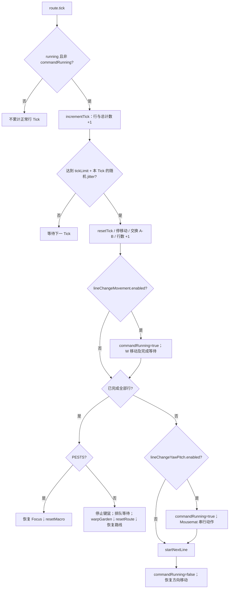

# Ultimate Garden — Code Structure

> 以当前工作区源码为准；本文说明本地实现，不把服务器响应或测试桩结果视为实机保证。代码定位以文件与函数为主。原文备份：[Code_Structure.backup.md](Code_Structure.backup.md)。

## Table of Contents

1. [Project Overview](#project-overview)
2. [Project Directory Structure](#project-directory-structure)
3. [Module Architecture](#module-architecture)
4. [Execution Flows](#execution-flows)
5. [Configuration Reference](#configuration-reference)
6. [UI Structure](#ui-structure)
7. [Hotkey Reference](#hotkey-reference)
8. [Code Navigation Index](#code-navigation-index)
9. [Testing & Build](#testing-build)
10. [Documentation Maintenance Rules](#documentation-maintenance-rules)

<a id="project-overview"></a>
## 1. Project Overview

Ultimate Garden 是客户端农业自动化 Mod，包含路线移动、loadout 操作、Pest 倒计时、Pest ESP、设置菜单及状态 HUD。PestLoadout 是装备切换流程，不是寻路或攻击害虫的 Macro。

| 项目 | 当前值 / 边界 |
|---|---|
| Mod ID / 版本 | `ultimate_garden` / `1.0.2` |
| Minecraft / Java | `26.1.2` / Java 25 |
| Mod Loader | Fabric Loader `0.19.3` |
| Fabric API | `0.155.2+26.1.2` |
| 构建工具 | Gradle 9.5.1；Loom 声明 `1.17-SNAPSHOT` |
| 技术架构 | Fabric 事件 + 原生 Screen / KeyMapping + Mixin + 客户端 Tick 队列 + Gson JSON |
| 渲染 | HUD 使用 GuiGraphicsExtractor；ESP 使用 Fabric LevelRenderEvents 与统一 RenderPipeline |
| 运行配置 | 按 Minecraft 账号隔离，选择、偏好与样式持久化；运行状态不落盘 |

主入口 [Ultimate_Garden](src/main/java/com/kuangsanfeng/ultimategarden/Ultimate_Garden.java) 提供 Mod 标识等基础设施；客户端组装入口为 [Ultimate_GardenClient.onInitializeClient](src/client/java/com/kuangsanfeng/ultimategarden/client/Ultimate_GardenClient.java)。业务主要在客户端，`fabric.mod.json` 仍包含模板描述和作者信息，不能据此推导额外功能。

**依赖方向：** 初始化器组装 Config / Input / Focus → FarmController 创建 Command / Route → MacroManager 分发 Tick；Hotkeys、聊天事件和 Menu 调用控制器。HUD 读取状态，ESP 提取实体并独立绘制。修改 HUD 不应驱动计时或 Macro；修改统一渲染器不应改动实体识别。

<a id="project-directory-structure"></a>
## 2. Project Directory Structure

以下列出全部核心 Java 源码与运行资源；路径中的包根为 `com/kuangsanfeng/ultimategarden`。不包含缓存和生成文件。目录树用于找文件，职责与调用入口见下一节。

```text
src/
├── client/
│   ├── java/
│   │   └── com/
│   │       └── kuangsanfeng/
│   │           └── ultimategarden/
│   │               └── client/
│   │                   ├── command/
│   │                   │   ├── CommandHelper.java
│   │                   │   ├── CommandListener.java
│   │                   │   └── CommandTree.java
│   │                   ├── config/
│   │                   │   ├── AccountDirectories.java
│   │                   │   ├── AccountIdentity.java
│   │                   │   ├── ConfigIO.java
│   │                   │   ├── ConfigManager.java
│   │                   │   ├── CropConfig.java
│   │                   │   ├── CropData.java
│   │                   │   ├── CropDefinition.java
│   │                   │   ├── ESPConfig.java
│   │                   │   ├── FarmConfig.java
│   │                   │   ├── GeneralConfig.java
│   │                   │   ├── HudConfig.java
│   │                   │   ├── PestConfig.java
│   │                   │   ├── RandomDelayConfig.java
│   │                   │   └── UIConfig.java
│   │                   ├── hint/
│   │                   │   ├── HintManager.java
│   │                   │   └── KeyNameMap.java
│   │                   ├── hotkey/
│   │                   │   └── MacroKeyBindings.java
│   │                   ├── input/
│   │                   │   ├── PlayerGuiInput.java
│   │                   │   ├── VirtualInput.java
│   │                   │   ├── VirtualKeyboard.java
│   │                   │   └── VirtualMouse.java
│   │                   ├── macro/
│   │                   │   ├── esp/
│   │                   │   │   ├── render/
│   │                   │   │   │   ├── ESPBoxRenderer.java
│   │                   │   │   │   ├── ESPFillRenderer.java
│   │                   │   │   │   └── ESPTracerRenderer.java
│   │                   │   │   ├── style/
│   │                   │   │   │   ├── ESPColorMode.java
│   │                   │   │   │   ├── ESPColorProvider.java
│   │                   │   │   │   ├── ESPStyle.java
│   │                   │   │   │   └── ESPTargetStyle.java
│   │                   │   │   ├── ESPManager.java
│   │                   │   │   ├── ESPRenderer.java
│   │                   │   │   └── ESPTarget.java
│   │                   │   ├── farm/
│   │                   │   │   ├── action/
│   │                   │   │   │   ├── FarmCommandController.java
│   │                   │   │   │   └── FarmCommandInput.java
│   │                   │   │   ├── crop/
│   │                   │   │   │   ├── CropDatabase.java
│   │                   │   │   │   └── CropType.java
│   │                   │   │   ├── hint/
│   │                   │   │   │   └── FarmHints.java
│   │                   │   │   ├── pest/
│   │                   │   │   │   ├── PestESP.java
│   │                   │   │   │   └── PestLoadoutTimer.java
│   │                   │   │   ├── route/
│   │                   │   │   │   ├── RouteController.java
│   │                   │   │   │   ├── RouteData.java
│   │                   │   │   │   ├── RouteDatabase.java
│   │                   │   │   │   ├── RouteKey.java
│   │                   │   │   │   ├── SetLineYP.java
│   │                   │   │   │   └── SlotSelector.java
│   │                   │   │   ├── FarmController.java
│   │                   │   │   ├── FarmState.java
│   │                   │   │   └── MacroConstants.java
│   │                   │   ├── GuiPauseState.java
│   │                   │   └── MacroManager.java
│   │                   ├── mixin/
│   │                   │   ├── ExampleClientMixin.java
│   │                   │   ├── InventoryInputMixin.java
│   │                   │   ├── KeyboardHandlerAccessor.java
│   │                   │   ├── KeyMappingAccessor.java
│   │                   │   ├── MenuFarmInputMixin.java
│   │                   │   ├── WindowsFocusMixin.java
│   │                   │   ├── WindowsInputMixin.java
│   │                   │   ├── WindowsMissTimeMixin.java
│   │                   │   ├── WindowsMouseMixin.java
│   │                   │   └── WindowsPauseMixin.java
│   │                   ├── scheduler/
│   │                   │   ├── ActionScheduler.java
│   │                   │   └── InputScheduler.java
│   │                   ├── ui/
│   │                   │   ├── hud/
│   │                   │   │   ├── HudAdjustmentController.java
│   │                   │   │   └── MacroStatusHud.java
│   │                   │   ├── language/
│   │                   │   │   ├── LanguageKeys.java
│   │                   │   │   ├── LanguageManager.java
│   │                   │   │   └── LanguageType.java
│   │                   │   ├── render/
│   │                   │   │   ├── MenuInputGraphics.java
│   │                   │   │   └── RoundedRect.java
│   │                   │   ├── screen/
│   │                   │   │   └── UltimateGardenScreen.java
│   │                   │   ├── theme/
│   │                   │   │   └── ThemePalette.java
│   │                   │   ├── widget/
│   │                   │   │   ├── CollapsibleSection.java
│   │                   │   │   ├── DropdownSelector.java
│   │                   │   │   ├── HelpTooltip.java
│   │                   │   │   ├── LanguageSelector.java
│   │                   │   │   ├── SelectionCheckbox.java
│   │                   │   │   ├── StyledButton.java
│   │                   │   │   ├── ToggleSwitch.java
│   │                   │   │   └── TransparencySlider.java
│   │                   │   └── MenuController.java
│   │                   ├── window/
│   │                   │   ├── WindowsFocusController.java
│   │                   │   ├── WindowsInputInterceptor.java
│   │                   │   ├── WindowsNativeBridge.java
│   │                   │   └── WindowsState.java
│   │                   └── Ultimate_GardenClient.java
│   └── resources/
│       ├── assets/
│       │   └── ultimate_garden/
│       │       ├── shaders/
│       │       │   └── core/
│       │       │       └── esp_tracer.vsh
│       │       └── textures/
│       │           └── gui/
│       │               └── language/
│       │                   ├── cn.png
│       │                   └── us.png
│       ├── ultimategarden/
│       │   └── default-crops.json
│       └── ultimate_garden.client.mixins.json
└── main/
    ├── java/
    │   └── com/
    │       └── kuangsanfeng/
    │           └── ultimategarden/
    │               ├── mixin/
    │               │   └── ExampleMixin.java
    │               └── Ultimate_Garden.java
    └── resources/
        ├── assets/
        │   └── ultimate_garden/
        │       ├── lang/
        │       │   ├── en_us.json
        │       │   └── zh_cn.json
        │       └── icon.png
        ├── fabric.mod.json
        └── ultimate_garden.mixins.json
```

根目录构建文件：[gradle.properties](gradle.properties)、[build.gradle](build.gradle)、[settings.gradle](settings.gradle)、[Gradle Wrapper](gradle/wrapper/gradle-wrapper.properties)。测试目录见 [Testing & Build](#testing-build)。

<a id="module-architecture"></a>
## 3. Module Architecture

### 3.1 启动与 Macro

- **职责：** 创建单例控制器、注册事件、分发农业生命周期；不另建第二套农业状态机。
- **关键文件：** [Ultimate_GardenClient](src/client/java/com/kuangsanfeng/ultimategarden/client/Ultimate_GardenClient.java)、[MacroManager](src/client/java/com/kuangsanfeng/ultimategarden/client/macro/MacroManager.java)、[FarmController](src/client/java/com/kuangsanfeng/ultimategarden/client/macro/farm/FarmController.java)、[FarmState](src/client/java/com/kuangsanfeng/ultimategarden/client/macro/farm/FarmState.java)、[GuiPauseState](src/client/java/com/kuangsanfeng/ultimategarden/client/macro/GuiPauseState.java)。
- **入口函数：** `onInitializeClient`、`MacroManager.register/start/pause/reset/tick`；Hotkey 版本通过 Module 默认接口或 Farm 覆盖实现分发。
- **工作流程：** Config → ESP 注册 → Window / VirtualInput → Farm → MacroManager → HUD / Screen / 生命周期 / Hotkey / Command 注册。START_CLIENT_TICK 检查 HUD 调整及账号变化；END_CLIENT_TICK 内 Hotkey 处理并调用 `manager.tick()`。
- **相关配置：** general、farm、crops；MacroManager 当前注册 FARM 模块，接口允许扩展，但没有实现其他独立 Macro 模块。

### 3.2 Farm 与 Route

- **职责：** FarmController 管启动、停止意图、菜单会话与业务入口；RouteController 管方向、行完成和下一行移动。
- **关键文件：** [FarmController](src/client/java/com/kuangsanfeng/ultimategarden/client/macro/farm/FarmController.java)、[FarmState](src/client/java/com/kuangsanfeng/ultimategarden/client/macro/farm/FarmState.java)、[RouteController](src/client/java/com/kuangsanfeng/ultimategarden/client/macro/farm/route/RouteController.java)、[SetLineYP](src/client/java/com/kuangsanfeng/ultimategarden/client/macro/farm/route/SetLineYP.java)、[CropConfig](src/client/java/com/kuangsanfeng/ultimategarden/client/config/CropConfig.java)、[CropDefinition](src/client/java/com/kuangsanfeng/ultimategarden/client/config/CropDefinition.java)。
- **入口函数：** `startMacro/pauseMacro/resetMacro/tick`、`RouteController.tick`、`runCurrentMovement`、`nextLine/previousLine`。
- **工作流程：** Tick 先推进命令队列，再推进正常行计时；额外移动 → 检查路线结束 → 可选 Mousemat → 下一行。暂停、取消和世界清理不由 HUD 控制。
- **相关配置：** farm、crops、random_delay。TIMETESTER 以所选模拟作物移动，但用 TIMETESTER 的行阈值。

### 3.3 Pest 与命令工作流

- **职责：** 发服务器命令、串行等待和输入动作；Pest 倒计时与农业行 Tick 分离。
- **关键文件：** [FarmCommandController](src/client/java/com/kuangsanfeng/ultimategarden/client/macro/farm/action/FarmCommandController.java)、[PestLoadoutTimer](src/client/java/com/kuangsanfeng/ultimategarden/client/macro/farm/pest/PestLoadoutTimer.java)、[CommandListener](src/client/java/com/kuangsanfeng/ultimategarden/client/command/CommandListener.java)、[CommandTree](src/client/java/com/kuangsanfeng/ultimategarden/client/command/CommandTree.java)、[CommandHelper](src/client/java/com/kuangsanfeng/ultimategarden/client/command/CommandHelper.java)。
- **入口函数：** `spawn/warpGarden/loadout`、`spawnPoint/spawnPests/pestLoadout`、`startPestLoadoutTimer`、`automateTaskByMonitorMessage`。
- **工作流程：** 客户端聊天初始化走 ALLOW_CHAT；服务端 GAME 消息分发到 MacroManager，再识别 Pest 消息并安排启动计时。延迟动作都进入命令控制器拥有的 ActionScheduler。
- **相关配置：** pest、random_delay。服务器是否接受命令、是否切换成功，不能仅由本地回调完成来证明。

### 3.4 ESP

- **职责：** PestESP 负责类型筛选；ESPManager 管模块提取和每帧快照；ESPRenderer 管统一绘制。
- **关键文件：** [PestESP](src/client/java/com/kuangsanfeng/ultimategarden/client/macro/farm/pest/PestESP.java)、[ESPManager](src/client/java/com/kuangsanfeng/ultimategarden/client/macro/esp/ESPManager.java)、[ESPTarget](src/client/java/com/kuangsanfeng/ultimategarden/client/macro/esp/ESPTarget.java)、[ESPRenderer](src/client/java/com/kuangsanfeng/ultimategarden/client/macro/esp/ESPRenderer.java)、[ESPBoxRenderer](src/client/java/com/kuangsanfeng/ultimategarden/client/macro/esp/render/ESPBoxRenderer.java)、[ESPFillRenderer](src/client/java/com/kuangsanfeng/ultimategarden/client/macro/esp/render/ESPFillRenderer.java)、[ESPTracerRenderer](src/client/java/com/kuangsanfeng/ultimategarden/client/macro/esp/render/ESPTracerRenderer.java)、[ESPColorProvider](src/client/java/com/kuangsanfeng/ultimategarden/client/macro/esp/style/ESPColorProvider.java)、[ESPStyle](src/client/java/com/kuangsanfeng/ultimategarden/client/macro/esp/style/ESPStyle.java)、[ESPTargetStyle](src/client/java/com/kuangsanfeng/ultimategarden/client/macro/esp/style/ESPTargetStyle.java)、[ESPColorMode](src/client/java/com/kuangsanfeng/ultimategarden/client/macro/esp/style/ESPColorMode.java)。
- **入口函数：** `PestESP.collect`、`ESPManager.register/initialize`、`ESPRenderer.draw/close`。
- **工作流程：** END_EXTRACTION 抓取实体 AABB / 插值 / 样式 → Frame → END_MAIN 画 fill、box、tracer。generation 防止账号 / 断线后的旧帧继续绘制。
- **相关配置：** pest 的开关 + esp 的样式。Bat 与 Silverfish 均使用内部 `SILVERFISH` 目标 ID；不按名称筛选、不区分是否真为 Hypixel 害虫，也没有独立 Bat 配置。

### 3.5 HUD

- **职责：** 只读状态展示；显示开关、内容及几何偏好管理。
- **关键文件：** [MacroStatusHud](src/client/java/com/kuangsanfeng/ultimategarden/client/ui/hud/MacroStatusHud.java)、[HudAdjustmentController](src/client/java/com/kuangsanfeng/ultimategarden/client/ui/hud/HudAdjustmentController.java)、[HudConfig](src/client/java/com/kuangsanfeng/ultimategarden/client/config/HudConfig.java)。
- **入口函数：** `MacroStatusHud.render`；调整模式 `begin/layout/move/button/tick/finish`。
- **工作流程：** 每帧读取状态和模式；普通 HUD 受 showHud、F1、玩家 / 世界及自身 Menu 隐藏条件控制。调整模式无新 Screen，临时离开原菜单并消费原生输入，退出保存。
- **相关配置：** hud；正向颜色沿用 UI accent。详细显示规则和几何约束见执行流程。

### 3.6 UI

- **职责：** 原生 Screen 的页面、草稿、校验、保存反馈及嵌套设置卡片。
- **关键文件：** [MenuController](src/client/java/com/kuangsanfeng/ultimategarden/client/ui/MenuController.java)、[UltimateGardenScreen](src/client/java/com/kuangsanfeng/ultimategarden/client/ui/screen/UltimateGardenScreen.java)、[CollapsibleSection](src/client/java/com/kuangsanfeng/ultimategarden/client/ui/widget/CollapsibleSection.java)、[ToggleSwitch](src/client/java/com/kuangsanfeng/ultimategarden/client/ui/widget/ToggleSwitch.java)、[DropdownSelector](src/client/java/com/kuangsanfeng/ultimategarden/client/ui/widget/DropdownSelector.java)、[StyledButton](src/client/java/com/kuangsanfeng/ultimategarden/client/ui/widget/StyledButton.java)、[SelectionCheckbox](src/client/java/com/kuangsanfeng/ultimategarden/client/ui/widget/SelectionCheckbox.java)、[LanguageSelector](src/client/java/com/kuangsanfeng/ultimategarden/client/ui/widget/LanguageSelector.java)、[TransparencySlider](src/client/java/com/kuangsanfeng/ultimategarden/client/ui/widget/TransparencySlider.java)、[HelpTooltip](src/client/java/com/kuangsanfeng/ultimategarden/client/ui/widget/HelpTooltip.java)、[RoundedRect](src/client/java/com/kuangsanfeng/ultimategarden/client/ui/render/RoundedRect.java)、[MenuInputGraphics](src/client/java/com/kuangsanfeng/ultimategarden/client/ui/render/MenuInputGraphics.java)、[ThemePalette](src/client/java/com/kuangsanfeng/ultimategarden/client/ui/theme/ThemePalette.java)。
- **入口函数：** `MenuController.open/saveFarmSelection`；Screen 的 `added/removed/onClose/keyPressed/build` 及各页面方法。
- **工作流程：** 选择 / Toggle 多数即时保存；作物路线使用 drafts 并统一 Apply；账号复制有确认和后续执行阶段。输入框草稿不能等同于已落盘配置。
- **相关配置：** 各模块 JSON；UI 显示由 ui 控制。整张 Disabled 卡片不可交互，开关保留真实 ON / OFF 颜色和位置；子卡片整体缩进。

### 3.7 Hotkeys、命令与提示

- **职责：** 原生按键绑定与上升沿分发；客户端命令；聊天提示与菜单语言映射。
- **关键文件：** [MacroKeyBindings](src/client/java/com/kuangsanfeng/ultimategarden/client/hotkey/MacroKeyBindings.java)、[CommandTree](src/client/java/com/kuangsanfeng/ultimategarden/client/command/CommandTree.java)、[CommandListener](src/client/java/com/kuangsanfeng/ultimategarden/client/command/CommandListener.java)、[CommandHelper](src/client/java/com/kuangsanfeng/ultimategarden/client/command/CommandHelper.java)、[HintManager](src/client/java/com/kuangsanfeng/ultimategarden/client/hint/HintManager.java)、[FarmHints](src/client/java/com/kuangsanfeng/ultimategarden/client/macro/farm/hint/FarmHints.java)、[KeyNameMap](src/client/java/com/kuangsanfeng/ultimategarden/client/hint/KeyNameMap.java)、[LanguageManager](src/client/java/com/kuangsanfeng/ultimategarden/client/ui/language/LanguageManager.java)、[LanguageType](src/client/java/com/kuangsanfeng/ultimategarden/client/ui/language/LanguageType.java)、[LanguageKeys](src/client/java/com/kuangsanfeng/ultimategarden/client/ui/language/LanguageKeys.java)。
- **入口函数：** `MacroKeyBindings.register/getBindings/getKeyName`；`HintManager.printHint/printRequired`、`FarmHints.printHint`。
- **工作流程：** 原生 KeyMapping 保持用户重绑；Mod UI 通过 LanguageManager 使用自身语言，不更改 Minecraft 当前语言。原生 Controls 名称则由 Minecraft 语言资源解析。普通聊天提示由 general 总开关与 hint 子项控制；必要提示逐项分类，未分类的 printRequired 保留原必要输出行为。
- **相关配置：** general、ui；默认绑定见专节。HintManager 的聊天快捷键帮助是独立列表，当前没有把 Toggle HUD 追加到该列表；Hotkeys 页面与原生 Controls 已包含该项。

聊天输出统一入口为 HintManager.isEnabled(event) / printFor(event,text)，配置在 general.json 的 hint 对象，15 个新增字段默认均为 true。FarmHints 两个分发重载和 HintManager.printHint 在分隔空行之前判定；PestLoadoutTimeUp 按两项 OR 决定是否输出组，再分别判断每条消息。showModChatHints 仍是原总开关，关闭不会改写子项。

| 触发事件 / 入口 | 发送路径与原消息 | hint 字段 |
|---|---|---|
| startMacro | FarmHints MacroStart → Macro Start | macroStart |
| pauseMacro | FarmHints ProgramPause → Program pause | macroPause |
| resetMacro | FarmHints ProgramReset → Program reset | macroReset |
| handleInitializeInput 完成 | FarmHints InitializeDone → Macro Initialized | macroInitialized |
| Route 完成 / 手动上下行 | FarmHints LineFinished → Now done line {line} | lineCompleted |
| TimeTester 暂停 | FarmHints TimeTesterCount → Ticks costed: {ticks} | timeTesterTicks |
| PestLoadoutTimer.start | FarmHints PestLoadoutTimerStart → PestLoadout Ticker Start | pestTimerStart |
| PestLoadoutTimer.cancel | FarmHints PestLoadoutTimerReset → PestLoadout Ticker Reset | pestTimerReset |
| command.tick 倒计时结束（含延后分支） | FarmHints PestLoadoutTimeUp → printFor(PestTimerDone) → PestLoadout Ticker Done | pestTimerDone |
| 同一到期事件的第二条输出 | printFor(PestLoadoutChange) → Run The Loadout Change Macro | pestLoadoutChange |
| releaseFocusWithHint / restoreFocusWithHint | HintManager FocusRelease / FocusRestore → Focus Released / Focus Restored | focusReleased / focusRestored |
| 作物 / 模式 / 模拟作物选择及 CropInfo | FarmHints 分发；两处未实现作物提示改走 printFor(CropSelect)，只改输出调用 | cropSelectionInitialization |
| /ultimategarden hotkey | HintManager Hotkey → 原实时绑定帮助列表 | hotkeyHelp |
| /ultimategarden help、helper、默认帮助及未知命令 | HintManager Helper / WrongCommand（含组内 printRequired） | commandHelpErrors |

动态作物信息仍从 CropConfig 现场读取；关闭选择提示不会跳过输入、改变初始化状态或默认选作物。原帮助列表不新增 / 删除条目；服务器消息监听与显示不受 Hint 配置影响。未知普通事件仍只遵守总开关；本地必要错误处理及日志不受显示开关控制。

### 3.8 Config 与账号

- **职责：** 默认值、字段校验、旧配置兼容、受保护文件和按账号复制事务。
- **关键文件：** [ConfigManager](src/client/java/com/kuangsanfeng/ultimategarden/client/config/ConfigManager.java)、[ConfigIO](src/client/java/com/kuangsanfeng/ultimategarden/client/config/ConfigIO.java)、[AccountDirectories](src/client/java/com/kuangsanfeng/ultimategarden/client/config/AccountDirectories.java)、[AccountIdentity](src/client/java/com/kuangsanfeng/ultimategarden/client/config/AccountIdentity.java) 及各 Config 类。
- **入口函数：** `activateAccount/load/save/reset/saveAll/copyConfiguration`、`ConfigIO.read/write/replaceTransaction`。
- **工作流程：** 先构建默认对象，再加载 JSON；保留长期对象引用供已有控制器读取。账号目录依 UUID 元数据验证，不能只凭目录名信任路径。
- **相关配置：** 八个模块 JSON + account.json 身份元数据；规则见 Configuration Reference。

### 3.9 Input、Scheduler 与 Focus

- **职责：** 将真实玩家输入与虚拟动作隔离；为串行动作提供 Tick 队列；管理 Mod 鼠标释放和玩家输入拦截。
- **关键文件：** [VirtualInput](src/client/java/com/kuangsanfeng/ultimategarden/client/input/VirtualInput.java)、[VirtualKeyboard](src/client/java/com/kuangsanfeng/ultimategarden/client/input/VirtualKeyboard.java)、[VirtualMouse](src/client/java/com/kuangsanfeng/ultimategarden/client/input/VirtualMouse.java)、[PlayerGuiInput](src/client/java/com/kuangsanfeng/ultimategarden/client/input/PlayerGuiInput.java)、[ActionScheduler](src/client/java/com/kuangsanfeng/ultimategarden/client/scheduler/ActionScheduler.java)、[InputScheduler](src/client/java/com/kuangsanfeng/ultimategarden/client/scheduler/InputScheduler.java)、[WindowsFocusController](src/client/java/com/kuangsanfeng/ultimategarden/client/window/WindowsFocusController.java)、[WindowsInputInterceptor](src/client/java/com/kuangsanfeng/ultimategarden/client/window/WindowsInputInterceptor.java)、[WindowsState](src/client/java/com/kuangsanfeng/ultimategarden/client/window/WindowsState.java) 及 mixin 目录。
- **入口函数：** `keyDown/keyUp/slot/mouseDown`、`suspendForMenu/resumeAfterMenu/reapplyHeldState`；`schedule/scheduleDelayTicks/scheduleAfterTicks/tick`；`releaseFocus/restoreFocus/reapplyCursorMode`。
- **工作流程：** actionKeys / actionAttack 用于会话内业务输入挂起和恢复；虚拟按键主要操作 KeyMapping，非调用操作系统输入模拟。Focus、输入拦截和 running 是三个独立状态。
- **相关配置：** 调度读取 random_delay，窗口状态本身不持久化。

### 3.10 Mixin 与兼容层边界

| 文件 | 当前用途 |
|---|---|
| [WindowsInputMixin](src/client/java/com/kuangsanfeng/ultimategarden/client/mixin/WindowsInputMixin.java)、[InventoryInputMixin](src/client/java/com/kuangsanfeng/ultimategarden/client/mixin/InventoryInputMixin.java) | 真实 GUI 输入来源与背包 click 队列跟踪；调整模式键盘拦截 |
| [WindowsMouseMixin](src/client/java/com/kuangsanfeng/ultimategarden/client/mixin/WindowsMouseMixin.java) | 普通输入拦截；调整模式拖拽转发与阻止原生 setAll 重新按下真实按键 |
| [WindowsFocusMixin](src/client/java/com/kuangsanfeng/ultimategarden/client/mixin/WindowsFocusMixin.java)、[WindowsPauseMixin](src/client/java/com/kuangsanfeng/ultimategarden/client/mixin/WindowsPauseMixin.java)、[WindowsMissTimeMixin](src/client/java/com/kuangsanfeng/ultimategarden/client/mixin/WindowsMissTimeMixin.java) | Screen 关闭后重新应用鼠标模式、失焦暂停例外、抓鼠后清理 missTime |
| [MenuFarmInputMixin](src/client/java/com/kuangsanfeng/ultimategarden/client/mixin/MenuFarmInputMixin.java) | 自身 Menu 不暂停时维持农业虚拟输入与原版攻击处理 |
| [KeyMappingAccessor](src/client/java/com/kuangsanfeng/ultimategarden/client/mixin/KeyMappingAccessor.java)、[KeyboardHandlerAccessor](src/client/java/com/kuangsanfeng/ultimategarden/client/mixin/KeyboardHandlerAccessor.java) | 取得实际绑定及调用键盘内部入口 |
| [ExampleMixin](src/main/java/com/kuangsanfeng/ultimategarden/mixin/ExampleMixin.java)、[ExampleClientMixin](src/client/java/com/kuangsanfeng/ultimategarden/client/mixin/ExampleClientMixin.java) | 模板注入类，保留而非业务控制器 |
| [CropDatabase](src/client/java/com/kuangsanfeng/ultimategarden/client/macro/farm/crop/CropDatabase.java)、[CropData](src/client/java/com/kuangsanfeng/ultimategarden/client/config/CropData.java) | JSON 定义的兼容访问 / 旧接口，不是另一套静态参数来源 |
| [RouteDatabase](src/client/java/com/kuangsanfeng/ultimategarden/client/macro/farm/route/RouteDatabase.java)、[RouteData](src/client/java/com/kuangsanfeng/ultimategarden/client/macro/farm/route/RouteData.java)、[RouteKey](src/client/java/com/kuangsanfeng/ultimategarden/client/macro/farm/route/RouteKey.java)、[SlotSelector](src/client/java/com/kuangsanfeng/ultimategarden/client/macro/farm/route/SlotSelector.java)、[MacroConstants](src/client/java/com/kuangsanfeng/ultimategarden/client/macro/farm/MacroConstants.java) | 遗留路线 / 辅助 API；当前 RouteController 不依赖其构建第二套路线 |
| [FarmCommandInput](src/client/java/com/kuangsanfeng/ultimategarden/client/macro/farm/action/FarmCommandInput.java)、[InputScheduler](src/client/java/com/kuangsanfeng/ultimategarden/client/scheduler/InputScheduler.java) | 旧逐字符命令输入实现；主命令流实际使用 FarmCommandController.sendCommand |
| [WindowsNativeBridge](src/client/java/com/kuangsanfeng/ultimategarden/client/window/WindowsNativeBridge.java) | 预留 OS 桥接；当前没有实现 Windows 前台切换 |
| `legacyMouseClickScheduler` | 初始化器中的兼容队列，没有 Tick 驱动；不要误当成主命令队列 |

<a id="execution-flows"></a>
## 4. Execution Flows

### 4.1 Tick、Macro 状态与生命周期

`MacroKeyBindings END_CLIENT_TICK → MacroManager.tick → FarmController.tick → command.tick → route.tick`。菜单会话 active 时改为 `tickMenuSession`，不调用普通 route.tick。

| 操作 | 调用链与状态 |
|---|---|
| Num+ 启动 | `shouldPauseByHotkey → startMacroByHotkey → startMacro`；会话 active 时只登记 START。正常启动要求已选可执行作物；running=true、开启输入拦截、按住攻击、运行当前方向 |
| Num+ 暂停 | `pauseMacroByHotkey → restoreFocusWithHint → pauseMacro(true)`；running=false、关闭拦截、释放农业输入并 cancel 命令队列 |
| Num- 重置 | `resetMacroByHotkey → resetMacro`；登记 RESET、清菜单动作及运行计数、释放输入、cancel 队列 |
| GUI 临时暂停 | `beginMenuPause` 挂起输入和队列；真实玩家 GUI 运行中另调用 `pauseMacro(false)`，不 cancel 原业务队列 |
| 世界 / 玩家失效 | `abortForWorldChange → command.abortWorld`；清会话、GUI 来源、输入、动作与 Pest 倒计时，并按配置恢复作物 / 模式选择 |

关键字段：

- FarmState：`running` 是农业开关；`commandRunning` 阻止正常农业阶段执行；`eventSelect=true` 对应 movementA，false 对应 movementB；`eventCount` 是已完成行数。
- `tick` 是当前行正常作业累计；`totalTicks` 同时在 incrementTick 中增加。resetTick / resetRoute 不清总数，reset 清总数。
- `LineChangePhase` 为 IDLE / MOVEMENT / YAW_PITCH，是展示阶段；`Workflow` 用于工作流观察，不作为替代业务状态机。
- `menuActions` 是 UI 排队的业务操作；`heldActions/actionsRestored` 是挂起恢复状态；`businessResumePending` 记录 PestLoadout 后是否应恢复先前运行。

### 4.2 农业路线与换行

来源：[RouteController.tick](src/client/java/com/kuangsanfeng/ultimategarden/client/macro/farm/route/RouteController.java)、[RouteController.onLineFinished](src/client/java/com/kuangsanfeng/ultimategarden/client/macro/farm/route/RouteController.java)、[RouteController.continueLine](src/client/java/com/kuangsanfeng/ultimategarden/client/macro/farm/route/RouteController.java)、[SetLineYP.setAlternate](src/client/java/com/kuangsanfeng/ultimategarden/client/macro/farm/route/SetLineYP.java)。



- 额外移动：固定前等 100ms → W down → `scheduleAfterTicks(durationTicks)` → W up → 固定后等 100ms → continueLine。默认 Cactus durationTicks=10，不是 20。
- Mousemat：完成行数偶数选 slot1，奇数选 slot2；选 Mousemat → VIEW_ATTACK 等待 → actionMouseDown → VIEW_RELEASE 等待 → actionMouseUp → VIEW_TOOL_SLOT 等待 → slot1 工具 → VIEW_RESUME_ATTACK 等待 → actionMouseDown → startNextLine。
- 两功能串行；最后一行仍先完成额外移动，再判断路线结束，结束分支不会再执行 Mousemat。
- yaw / pitch 配置提供路线信息与提示；实际切视角用 Mousemat 物品动作，不是直接对玩家调用 setYRot / setXRot。
- 行阈值 jitter **每次 route.tick 都采样**，不是开行时只采样一次。
- 已知边界：`finishFarmRoute` 的 500ms 等待及 Warp 没有像额外换行阶段那样统一设置 commandRunning；不能笼统声称所有命令等待都冻结行计时。

### 4.3 Spawn、Warp 与 Loadout

来源：[FarmController.spawn](src/client/java/com/kuangsanfeng/ultimategarden/client/macro/farm/FarmController.java)、[FarmController.executeSpawnSequence](src/client/java/com/kuangsanfeng/ultimategarden/client/macro/farm/FarmController.java)、[FarmController.executeSpawnPointAndPests](src/client/java/com/kuangsanfeng/ultimategarden/client/macro/farm/FarmController.java)、[FarmCommandController](src/client/java/com/kuangsanfeng/ultimategarden/client/macro/farm/action/FarmCommandController.java)。

| 工作流 | 实际顺序 / 结束条件 |
|---|---|
| Num* Spawn | 正在农业运行则 pauseMacro → 排队固定 200ms → Mushroom 先 S + A/D 随机移动 → spawnPoint 发送 `spawnlocation` → SPAWN_POINT 等待 → restoreFocusWithHint → PESTS 模式继续 spawnPests |
| Spawn 的 Mushroom 方向 | `eventCount / 2 != 0` 决定 moveRight；不要误写为按奇偶交替 |
| spawnPests | 固定 100ms 后 slot7 → 固定 250ms 后 `loadout` → 等 GUI → slot5 → 等关闭并重新应用当前 Focus → SPAWN_INVENTORY_KEY 等待后虚拟 E → 固定 300ms 后结束 |
| Warp Garden | FarmController 先停键鼠、slot1 → command.warpGarden 发 `warp garden` → WARP 等待 → PESTS 模式回调释放 Focus 并尝试 startMacro；路线结束触发的 Warp 使用另一个复位路线回调 |
| 手动 Loadout | 正在运行则 pauseMacro → command.loadout 发 `loadout` → 重新应用当前 Focus → 固定 400ms 后回调；此入口不负责自动选装备或可靠等待 GUI 关闭 |

`warpGarden/spawnPoint/spawnMushroomMovement/loadout/pestLoadout/spawnPests` 在队列忙时可能直接 return，不是自动排入另一条并发流程。Menu 操作先放入 menuActions，等队列空后逐个执行。

### 4.4 PestLoadout 与异步等待

来源：[CommandListener.register](src/client/java/com/kuangsanfeng/ultimategarden/client/command/CommandListener.java) → [FarmController.automateTaskByMonitorMessage](src/client/java/com/kuangsanfeng/ultimategarden/client/macro/farm/FarmController.java) → [FarmCommandController.startPestLoadoutTimer](src/client/java/com/kuangsanfeng/ultimategarden/client/macro/farm/action/FarmCommandController.java)。

1. 自动路径要求 autoPestLoadout=true，系统消息包含源码字面量 `Pest have spawned in Plot`；安排 100ms 后启动。手动计时入口不要求自动选项开启。
2. startPestLoadoutTimer 只在 PESTS 模式启动，读取当时的 delayTicks；修改延迟不会重置正在运行的倒计时。
3. 每次 command.tick 先推进 scheduler，再推进 PestLoadoutTimer；农业 running=false 仍可推进。
4. 到期且不在菜单会话：保存 wasRunning；若正在运行调用 pauser；标记 businessResumePending；执行 pestLoadout。成功回调仅在 wasRunning 时调用 resumer。
5. 到期且在菜单会话：记 pendingPestLoadout；待 holdActions=false 且队列空再执行，避免被菜单挂起的队列死锁。
6. pestLoadout：发 `loadout` → PEST_OPEN_WAIT → Step2 等 screen 非 null → PEST_SELECT 后 slot4 → PEST_SETTLE → Step3 检查关闭；若仍有 Screen 则 setScreen(null) 再等；关闭后应用当前 Focus，固定 300ms 后回调。
7. Step2 最多 40 次 50ms 调度，Step3 最多 20 次 100ms 调度；超限 failAction，不执行正常成功恢复。spawnPests 的对应等待结构相同，选 slot5 并执行后续 E。

**实现边界：** 检查是 `screen != null` / `screen == null`，没有核验标题、菜单 ID 或服务器装备结果。轮询周期含 ActionScheduler 的执行 Tick 语义，源码注释的毫秒乘积不是严格墙钟超时。Pest ESP 不参与这些流程。

### 4.5 GUI 自动暂停与恢复

来源：[WindowsInputMixin](src/client/java/com/kuangsanfeng/ultimategarden/client/mixin/WindowsInputMixin.java)、[InventoryInputMixin](src/client/java/com/kuangsanfeng/ultimategarden/client/mixin/InventoryInputMixin.java)、[PlayerGuiInput](src/client/java/com/kuangsanfeng/ultimategarden/client/input/PlayerGuiInput.java) → ScreenEvents.AFTER_INIT → [FarmController.onPlayerScreenOpened](src/client/java/com/kuangsanfeng/ultimategarden/client/macro/farm/FarmController.java)。

| GUI 来源 | 当前规则 |
|---|---|
| 玩家真实背包、ESC、聊天框 | 来源校验通过才自动暂停；useGameFocusForPlayerGui 结束 Mod 释放覆盖；关闭不使用菜单 Auto-resume |
| Mod 自身 Menu | added 调用 beginUltimateGardenMenu，按 autoPauseFarmWhenOpeningMenu 决定是否建立会话；removed 仅结束本次拥有的会话 |
| 虚拟背包 | virtualDispatch 来源不会被判为玩家背包输入 |
| 箱子、服务器 GUI、其他 Mod Screen | 不作为新增自动暂停入口；已有活动会话可能仍因 Screen 存在而等待，不等于“完全忽略所有容器” |

背包来源跟随实际绑定的 KeyMapping.click / consumeClick 队列，不依赖固定 E。clearTransient 仅清瞬时请求；inventoryOpening / inventoryClicks 按消费及 releaseAll 生命周期清理，防止跨 Tick 丢失和过期误判。

GuiPauseState：

- Source 为 ULTIMATE_GARDEN_MENU / PLAYER_GUI；每次 open 更新菜单自动恢复资格，已有会话保留原意图快照。
- Intent 为 NONE / START / PAUSE / RESET；START 是明确请求，独立于自动恢复开关；PAUSE / RESET 取消恢复资格，fail 阻止恢复。
- `endMenuPause` 固定 close(false)；`endUltimateGardenMenu` 才传入菜单 Auto-pause / Auto-resume 条件。
- close 只记录意图；最终恢复还要等 `tickMenuSession`：无菜单 / 阻挡 Screen / Overlay，焦点可恢复，业务队列和 menuActions 已完成，finish 才可调用 startMacro。
- 挂起业务动作恢复后，属于当前 loadout 的容器可被 ownedBusinessScreen 判为允许操作；并非允许农业在容器中继续执行。
- Menu 的 Auto-pause=OFF 时，keepsFarmingInput 与 MenuFarmInputMixin 维持真实虚拟键位、攻击处理和计时；不能只依赖 running=true。Menu 内主动暂停、重置仍是明确用户操作。

### 4.6 Focus 与 Input Interception

来源：[WindowsState](src/client/java/com/kuangsanfeng/ultimategarden/client/window/WindowsState.java)、[WindowsFocusController](src/client/java/com/kuangsanfeng/ultimategarden/client/window/WindowsFocusController.java)、[WindowsInputInterceptor](src/client/java/com/kuangsanfeng/ultimategarden/client/window/WindowsInputInterceptor.java)、[WindowsFocusMixin](src/client/java/com/kuangsanfeng/ultimategarden/client/mixin/WindowsFocusMixin.java)。

| 状态 | 含义 |
|---|---|
| FarmState.running | 农业路线是否运行 |
| WindowsState.inputIntercepting | Mod 是否请求阻断玩家输入；自身 Menu 通过 uiInputAllowed 放行交互 |
| WindowsState.mouseReleased | Mod 主动释放 OS 鼠标的模式，不是“任何 GUI 存在”的标记 |
| MouseHandler.isMouseGrabbed / GLFW cursor mode | 原生逻辑捕获与 OS 光标模式，允许为虚拟持续破坏而有意分离 |

- releaseFocus：写 Mod 标记并 reapplyCursorMode；无 Screen 时可保持逻辑 grab、仅让 OS 光标自由。
- restoreFocus：清标记、应用原生捕获；原先 Released 时调用 restoreInputState，但 Farm 有 running / menu / commandRunning 守卫。
- useGameFocusForPlayerGui：真实 GUI 打开时清 Mod 标记，调用统一 reapply；因 Screen 存在仍 releaseMouse + GLFW_CURSOR_NORMAL，不恢复农业输入。
- restoreGameMouseAfterMenu：只在无 Screen 且玩家 / 世界有效时恢复游戏捕获，不调用 Macro 输入恢复回调。
- setScreen 返回后 WindowsFocusMixin 重新应用当前模式，防止原版容器关闭覆盖工作流要求的自由鼠标。
- 普通输入拦截的键盘列表是 W/A/S/D、Space、Slash；不是所有键。鼠标按钮、移动和滚轮另行拦截。调整模式使用单独临时路由，不改上述持久状态。
- HUD 在 Screen 存在时显示 GUI Cursor；无 Screen 才显示 Mod Released / Captured。Released 蓝绿色、Captured 红色；它不是输入拦截布尔值的别名。

### 4.7 HUD 渲染与调整

来源：[MacroStatusHud.render](src/client/java/com/kuangsanfeng/ultimategarden/client/ui/hud/MacroStatusHud.java)、[HudAdjustmentController](src/client/java/com/kuangsanfeng/ultimategarden/client/ui/hud/HudAdjustmentController.java)、[UltimateGardenScreen.finishHudAdjustment](src/client/java/com/kuangsanfeng/ultimategarden/client/ui/screen/UltimateGardenScreen.java)。

- 普通 HUD：Menu 打开时隐藏；showHud=false 时隐藏；不改变计数。深色半透明背景，Running 蓝绿色 / Paused 红色边框与进度条；普通文本和数值白色，分割线灰绿色。
- 状态颜色按具体字段读取：Released / ON 正向，Captured / OFF / Disable 反向；启用时的 duration tick 与 Mousemat slot 值仍白色。工作流挂起和活动、停止原因按原始状态分类，不按翻译后文字匹配。
- 模式选择先改配置并保存，再 build 刷新 UI；renderer 不缓存模式。
- 调整入口保留原 Screen 实例，置 adjustingHud 后 setScreen(null)；removed 不结束原暂停会话。背景只做半透明暗色覆盖，不执行真正的场景去色 Shader。
- render 绘制边框 / 四角手柄和说明，并提供 layout 几何；move 将原始鼠标坐标转换为 GUI 坐标，按内部 / 四边 / 四角拖动写归一化 bounds。
- 最小尺寸取自然布局的 65%（受窗口大小限制），矩形夹在可见区域；内容等比适配卡片，非任意字体重排。
- 临时键盘拦截先于 GUI 来源检测；真实 ESC → finish(true)，清理标准光标、保存 HUD、回到原 Settings 页面。原有暂停会话不重复建立；若原来未暂停而当前已开启 Auto-pause，返回时按当前设置处理。
- 无 Screen 调整期间自由 OS 光标、屏蔽真实输入与视角；不写 Focus / Macro 标志。隐藏 HUD 也可预览调整，退出不修改 showHud。
- 世界变化、其他 Screen、断线、退出和账号切换会 finish(false) 并清理；不保证异常进程终止时还能保存。

### 4.8 JSON 加载、迁移与保存

[ConfigManager.activateAccount](src/client/java/com/kuangsanfeng/ultimategarden/client/config/ConfigManager.java) → defaults / 清保护集合 → AccountDirectories.resolve 验证身份 → 逐模块 load → 校验 / 迁移 → 非 protected 文件 save。

- 配置根目录为 `FabricLoader configDir/ultimategarden/<账号名>/`，不是固定共享根目录；account.json 记录 schemaVersion、uuid、name。legacy 根目录只作为已验证的导入来源。
- ConfigIO 严格读取单个 JSON object；写入临时文件后原子移动，系统不支持时回退替换。
- 较新 schema 使用内存默认值并禁止覆盖；I/O 不可读文件也受保护；非法 JSON / 字段先备份，备份失败不覆盖原文。
- CropConfig 保留用户字段并补新增换行字段；旧合并作物节点拆分；旧数值作物选择要求重选，不猜测新版 ID。
- ESP schema 1 → 2 将旧样式移入 general / targets，迁移前备份；未知字段尽量保留。
- 账号复制验证 revision、UUID、路径和源 JSON，replaceTransaction 提供回滚；复制到当前账号时 FARM / CROPS 记 pendingRestart，其余模块可重载。不要把复制成功解释为所有模块已立即应用。

### 4.9 调度和计时语义

| 计时源 | 暂停 / 结束行为 |
|---|---|
| 农业 tick / totalTicks | RouteController 正常作业路径才增加；暂停与额外换行 commandRunning 阶段不增加 |
| ActionScheduler | setPaused(true) 冻结 remainingTicks；clear 清队列和当前动作；每 Tick 最多执行一项，回调中新排任务以后再运行 |
| schedule(ms) | ceil(ms/50) 转 Tick；倒计时归零后在后续执行 Tick 回调，不是精确墙钟延时 |
| scheduleDelayTicks(n) | 与旧 schedule 的执行 Tick 语义一致；n=0 仍是队列任务 |
| scheduleAfterTicks(n) | 内部使用 n-1，保证两个串行回调间的精确 Tick 间隔；用于移动持续时长 |
| PestLoadoutTimer | 即使 queue held / Macro 暂停也由 command.tick 推进；手动 pause/reset 的 command.cancel 不取消计时器，显式取消或 abortWorld 才结束 |
| Rainbow / Tooltip | 渲染时间 / UI 时间机制，不是农业行计时 |

<a id="configuration-reference"></a>
## 5. Configuration Reference

### 5.1 文件与主要默认值

所有模块都有 schemaVersion；ESP 为 2，其余模块为 1。类链接直接对应读取 / 校验代码。

| 文件 / 类 | 主要字段与默认值 |
|---|---|
| general.json / [GeneralConfig](src/client/java/com/kuangsanfeng/ultimategarden/client/config/GeneralConfig.java) | showModChatHints=true；hint 的 15 个子项均 true（字段见模块 3.7）；autoPauseFarmWhenOpeningMenu=true；autoResumeFarmAfterGuiClose=false（仅自身 Menu） |
| farm.json / [FarmConfig](src/client/java/com/kuangsanfeng/ultimategarden/client/config/FarmConfig.java) | selectedCropType=NONE；selectedFarmMode=FARM；selectedSimulatedCropType=WHEAT |
| ui.json / [UIConfig](src/client/java/com/kuangsanfeng/ultimategarden/client/config/UIConfig.java) | uiThemeMode=SYSTEM（当前按浅色回退）；accentColor=#1B978C；language=ENGLISH；menuTransparency=0，范围 0–100 |
| pest.json / [PestConfig](src/client/java/com/kuangsanfeng/ultimategarden/client/config/PestConfig.java) | autoPestLoadout=true；pestLoadoutDelayTicks=2500；pestESPEnabled=true；已有 false 保留 |
| crops.json / [CropConfig](src/client/java/com/kuangsanfeng/ultimategarden/client/config/CropConfig.java) | crops.<CropType> 独立节点；内置默认来源 [default-crops.json](src/client/resources/ultimategarden/default-crops.json) |
| esp.json / [ESPConfig](src/client/java/com/kuangsanfeng/ultimategarden/client/config/ESPConfig.java) | general.throughWalls=true；general.rainbowCycleDurationMs=3000；targets.SILVERFISH 下 box / fill / tracer |
| random_delay.json / [RandomDelayConfig](src/client/java/com/kuangsanfeng/ultimategarden/client/config/RandomDelayConfig.java) | 每个 Key 为 {minTicks,maxTicks}；全作物共用，不写入 crops |
| hud.json / [HudConfig](src/client/java/com/kuangsanfeng/ultimategarden/client/config/HudConfig.java) | showHud=true；displayMode=COMPACT；compact / detail 布尔集合；bounds={x:0,y:0,width:0,height:0} |

ESP：box 默认 enabled=true、SOLID、#00FFAA、alpha=1、lineWidth=2；fill 为 true、RAINBOW、#00BFFF、alpha=.25；tracer 为 true、SOLID、#FFAA00、alpha=1、lineWidth=1.5。alpha 0–1，线宽 0.5–16；实体主开关在 pest，不在目标对象中新增 enabled。

HUD：width / height=0 表示自动尺寸；非零 bounds 均为相对 GUI 画面比例，字段要求有限且在 0–1。compact / detail 加载会保证 Compact 已启用的项在 Detail 为 true。显示开关与计时无关联。

### 5.2 作物参数

`name/enabled/tickLimit/totalLines/movementA/movementB/yawA/yawB/pitchA/pitchB`，可选 hintYaw / hintPitch 字段；alternateSlot 为旧兼容字段，运行切视角以 lineChangeYawPitch 为准。

| 默认作物 | tickLimit / totalLines | 额外移动 | Mousemat |
|---|---:|---|---|
| WHEAT | 806 / 15 | OFF，10 tick | OFF，3 / 4 |
| FLOWER | 544 / 16 | OFF，10 tick | OFF，3 / 4 |
| COCOA | 797 / 45 | OFF，10 tick | OFF，3 / 4 |
| MELON | 560 / 23 | OFF，10 tick | OFF，3 / 4 |
| PUMPKIN | 560 / 23 | OFF，10 tick | OFF，3 / 4 |
| SUGARCANE | 475 / 30 | OFF，10 tick | ON，3 / 4 |
| MUSHROOM | 800 / 15 | OFF，10 tick | ON，3 / 4 |
| CACTUS | 272 / 30 | ON，10 tick | OFF，3 / 4 |
| CARROT | 806 / 15 | OFF，10 tick | OFF，3 / 4 |
| POTATO | 806 / 15 | OFF，10 tick | OFF，3 / 4 |
| NETHER_WART | 806 / 15 | OFF，10 tick | OFF，3 / 4 |
| TIMETESTER | 99999 / 99999 | OFF，10 tick | OFF，3 / 4 |
| Custom1 / Custom2 / Custom3 | 无可执行路线 | OFF，durationTicks=10 | OFF，slot1=3 / slot2=4 |

- 内置作物 enabled=true；Custom 默认 false，且 isExecutable 明确拒绝 Custom，即使编辑 JSON 开启也不能当作已完成的自定义路线功能。
- lineChangeMovement.enabled 与 lineChangeYawPitch.enabled 相互独立；durationTicks>=1，slot1 / slot2 为 1–9。旧 JSON 缺失时按 bundled defaults 补齐有效值，不覆盖已有合法参数。
- movement 数组只接受不重复 W/S/A/D 且非空；普通 tickLimit / totalLines 必须为正整数，yaw ±180 / pitch ±90。详见 [CropDefinition](src/client/java/com/kuangsanfeng/ultimategarden/client/config/CropDefinition.java) 与 [CropConfig.updateCrop](src/client/java/com/kuangsanfeng/ultimategarden/client/config/CropConfig.java)。

### 5.3 随机延迟参数

默认范围由源码旧毫秒离散分布转换；保留默认范围时不是简单均匀 Tick 抽样，自定义范围使用含两端的均匀整数；min=max 为固定等待。所有范围要求 0<=min<=max。

| Key | 默认 tick | 位置 |
|---|---|---|
| FARM_ROW_JITTER | 0–9 | 正常行阈值，每 Tick 重新采样 |
| VIEW_ATTACK / VIEW_RELEASE / VIEW_TOOL_SLOT / VIEW_RESUME_ATTACK | 各 2–5 | Mousemat 四阶段 |
| WARP | 16–32 | warp garden 后 |
| SPAWN_POINT | 6–9 | spawnlocation 后 |
| SPAWN_MUSHROOM | 3–6 | Spawn 前 Mushroom 移动 |
| PEST_OPEN_WAIT / SPAWN_LOADOUT_OPEN_WAIT | 各 1–2 | loadout 初次等待 |
| PEST_SELECT / SPAWN_LOADOUT_SELECT | 各 3–7 | loadout 选装前 |
| PEST_SETTLE / SPAWN_LOADOUT_SETTLE | 各 2–3 | 选装后等待 |
| SPAWN_INVENTORY_KEY | 3–8 | spawnPests 最后虚拟背包按键 |

普通 loadout 的 400ms、换行前后 100ms、Spawn 入口 200ms 和业务轮询上限都是固定业务等待，不是这些随机字段。

<a id="ui-structure"></a>
## 6. UI Structure

来源为 [UltimateGardenScreen](src/client/java/com/kuangsanfeng/ultimategarden/client/ui/screen/UltimateGardenScreen.java) 的构建函数；下列按当前页面层级列出。英文名称与 [语言资源](src/main/resources/assets/ultimate_garden/lang/en_us.json) 对应，动态项按字段 / 枚举展开，不把未使用资源当成菜单。

```text
Ultimate Garden Menu
├─ 顶栏：LanguageSelector（English / Chinese）、关闭
├─ Home
│  └─ Your garden, at a glance
│     ├─ 运行状态、实际作物、模式 / A-B、行数 / Tick、进度、Pest 计时、待处理任务
│     └─ Start / Start after closing menu、Pause、Reset
├─ Farm
│  ├─ Farm configuration
│  │  ├─ Selected crop、Farm mode（Farm / Pests）
│  │  └─ Simulated crop（仅 TIMETESTER）
│  ├─ Farm macro command
│  │  └─ Previous Line、Next Line、Set Spawn、Warp Garden、Loadout
│  └─ Crop route definition
│     ├─ Crop to inspect/edit、name、enabled（Custom 为未完成提示）
│     ├─ Apply And Save Crop Definition
│     ├─ Line Change Movement
│     ├─ Movement Duration (ticks)
│     ├─ Line Change Squeaky Mousemat
│     ├─ Squeaky Mousemat 1 slot
│     ├─ Squeaky Mousemat 2 slot
│     └─ tickLimit、totalLines、movementA/B、yawA/B、pitchA/B、存在的 hintYaw/Pitch
├─ Pests
│  └─ Pest Loadout
│     ├─ Automatic pest loadout、当前计时 / 延迟信息
│     ├─ Delay ticks 输入、Save delay（下次倒计时生效）
│     └─ Start timer manually、Cancel timer
├─ ESP
│  ├─ General ESP settings
│  │  └─ Through walls（box/fill）、Rainbow cycle（milliseconds）
│  └─ Pest ESP
│     ├─ Enable Pest ESP
│     ├─ Box → enabled、color mode、color、alpha、line width
│     ├─ Fill → enabled、color mode、color、alpha
│     └─ Tracer → enabled、color mode、color、alpha、line width
├─ Hotkeys
│  └─ 全部 13 个 Binding 的名称 / Hint / 当前绑定（见快捷键表）
└─ Settings
   ├─ Preferences
   │  └─ Auto-pause farming when opening menu
   │     └─ Auto-resume farming after closing menu
   ├─ Hint
   │  ├─ Show Mod Chat Hints（总开关）
   │  ├─ Macro Hints（默认折叠）
   │  │  └─ Macro Start、Macro Pause、Macro Reset、Macro Initialized、Line Completed、TimeTester Ticks
   │  ├─ PestLoadout Hints（默认折叠）
   │  │  └─ Timer Start、Timer Reset、Timer Done、Loadout Change
   │  ├─ Focus Hints（默认折叠）
   │  │  └─ Focus Released、Focus Restored
   │  ├─ Crop Selection & Initialization
   │  ├─ Hotkey Help
   │  └─ Command Help & Errors
   ├─ HUD
   │  ├─ Show HUD
   │  ├─ Adjust HUD Position & Size
   │  ├─ Display Mode → Compact / Detail
   │  ├─ Compact Mode Content → 全部 HudConfig.Item
   │  └─ Detail Mode Additional Content → 同一 Item 集合
   ├─ Anti-Check
   │  └─ Random Delay
   │     └─ 每个 RandomDelayConfig.Key 独立四级分组
   │        └─ Min Ticks、Max Ticks、Save
   ├─ Appearance
   │  ├─ Theme（Light/Dark/System）
   │  ├─ Accent color、Apply accent color
   │  └─ Menu Transparency
   └─ Account Configuration
      ├─ Source account、Target account
      ├─ 八个模块文件复选框、All、None
      └─ Copy → 确认页 → 执行 / 报告 / 必要时 restart 提示
```

附属交互：DropdownSelector 使用同 Screen 的选择列表及 Cancel；LanguageSelector 是顶栏选择层；HelpTooltip 无 Hint 时不画提示图标；复制确认页含来源、目标、文件和确认 / 取消，复制执行阶段暂时禁用导航。

Crop Route 的 Enter / 小键盘 Enter 只在 routeInputs 中的可用输入框聚焦时触发；与 Apply 共用 applyCropDefinition，经 act 处理失败反馈，enterHeld 阻止长按重复保存。Custom 没有普通路线字段，保存与换行配置控件仍有显示，但不意味着能够启动。

HUD 内容默认：

| 类别 | Item |
|---|---|
| Compact 默认 ON | MACRO_STATUS、FARM_MODE、CROP、LINE、LINE_TICK、PEST_LOADOUT、FOCUS_STATE、INPUT_INTERCEPTION |
| Detail 在以上基础默认 ON | LINE_CHANGE、MOUSEMAT |
| 两者默认 OFF | TOTAL_TICK、CURRENT_DIRECTION、LINE_CHANGE_STATUS、STOP_REASON、CURRENT_WORKFLOW |

setCompact(item,true) 实际强制 Detail=true 且 Detail 该项不可交互；Compact 取消时 Detail 同步 false，随后可独立选择。与 Preferences 不同：Auto-pause=OFF 只禁用 Auto-resume 交互，不改 Auto-resume 原值。Disabled Toggle 仍显示真实 ON 的主题颜色。Hint 总开关关闭时，六组子项均禁用：三个折叠头及其四级开关、三个独立 Toggle 都沿用 40% Disabled 样式，折叠状态及子项配置不变；重新开启立即恢复可编辑状态。

<a id="hotkey-reference"></a>
## 7. Hotkey Reference

注册源 [MacroKeyBindings](src/client/java/com/kuangsanfeng/ultimategarden/client/hotkey/MacroKeyBindings.java)；分类 `Ultimate Garden`。所有默认键由原生 KeyMapping 注册，玩家在 Minecraft Controls 修改；不要直接从固定字符推导真实键位。UI 名称映射为 [LanguageKeys.hotkey](src/client/java/com/kuangsanfeng/ultimategarden/client/ui/language/LanguageKeys.java)，原生名称为 `key.ultimate_garden.<id>`，英文资源提供其他语言的回退。

| 名称 / ID | 默认绑定 | 主要入口 |
|---|---|---|
| Start / Pause / macro_toggle | Num+ | FarmController.shouldPauseByHotkey → startMacroByHotkey / pauseMacroByHotkey |
| Reset / macro_reset | Num- | resetMacroByHotkey |
| Next Line / next_line | ] | nextLine |
| Previous Line / previous_line | [ | previousLine |
| Set Spawn / spawn | Num* | spawnByHotkey → spawn |
| Warp Garden / warp | Num/ | warpGarden |
| Pest Timer / pest_loadout | Num7 | command.startPestLoadoutTimer |
| Cancel Pest Timer / pest_timer_cancel | Num4 | command.cancelPestLoadoutTimer |
| Loadout / loadout | Num9 | loadout |
| Select Crop / crop_change | Num. | changeCropType |
| Toggle HUD / toggle_hud | None / 未绑定 | 切换 hud.showHud 并保存 HUD 模块 |
| Mouse Focus / window_focus | U | WindowsFocusController.toggle |
| Open Ultimate Garden Menu / open_menu | M | MenuController.open；Screen 内 matchesMenuKey 关闭 |

- 多数业务键使用 KeyEdge 的 isDown 上升沿；Open Menu 消费 click 队列，自身 Screen 的菜单键在文本编辑时不关闭菜单。
- Num+ / Num- 在 manager.tick 前处理；Toggle HUD 也位于早期分支，独立于 Macro 控制。Menu 会话 active 后返回，不再处理后续路线 / 业务 Hotkey。
- Toggle HUD 使用自己的上升沿并清点击队列，排除其他 Screen、文本编辑和 HUD 调整模式；修改同一配置对象，所以 Settings getter 与实际渲染一致。
- 共享按键冲突沿用 Minecraft 注册机制；代码没有实现一个保证所有冲突都只能执行一个动作的仲裁器。
- 聊天初始化：Select Crop → changeCropType 打开 ChatScreen → ALLOW_CHAT → handleInitializeInput 依次读取作物 / 模式，TIMETESTER 还需模拟作物。程序打开的聊天不当作玩家 GUI 自动暂停来源。

<a id="code-navigation-index"></a>
## 8. Code Navigation Index

| 修改目标 | 首选文件 / 函数 | 调用链 / 关键状态 |
|---|---|---|
| 初始化注册或生命周期 | [Ultimate_GardenClient.onInitializeClient](src/client/java/com/kuangsanfeng/ultimategarden/client/Ultimate_GardenClient.java) | 配置先于控制器；账号 / 断线清理 |
| Macro 启停、重置 | [FarmController.startMacro](src/client/java/com/kuangsanfeng/ultimategarden/client/macro/farm/FarmController.java)、[FarmController.pauseMacro](src/client/java/com/kuangsanfeng/ultimategarden/client/macro/farm/FarmController.java)、[FarmController.resetMacro](src/client/java/com/kuangsanfeng/ultimategarden/client/macro/farm/FarmController.java) | running、menuPause、inputIntercepting |
| 行 Tick / 总 Tick | [RouteController.tick](src/client/java/com/kuangsanfeng/ultimategarden/client/macro/farm/route/RouteController.java)、[FarmState.incrementTick](src/client/java/com/kuangsanfeng/ultimategarden/client/macro/farm/FarmState.java) | tick、totalTicks、commandRunning |
| 普通移动 / A-B | [RouteController.runCurrentMovement](src/client/java/com/kuangsanfeng/ultimategarden/client/macro/farm/route/RouteController.java) | CropDefinition.getMovementKeys(eventSelect) |
| 换行额外移动 | [FarmCommandController.lineChangeMovement](src/client/java/com/kuangsanfeng/ultimategarden/client/macro/farm/action/FarmCommandController.java) | RouteController.onLineFinished → continueLine |
| Mousemat 顺序与槽位 | [SetLineYP.setAlternate](src/client/java/com/kuangsanfeng/ultimategarden/client/macro/farm/route/SetLineYP.java)、[SetLineYP.setView](src/client/java/com/kuangsanfeng/ultimategarden/client/macro/farm/route/SetLineYP.java) | continueLine → startNextLine；同一个 scheduler |
| Spawn / Num* | [FarmController.executeSpawnSequence](src/client/java/com/kuangsanfeng/ultimategarden/client/macro/farm/FarmController.java)、[FarmController.executeSpawnPointAndPests](src/client/java/com/kuangsanfeng/ultimategarden/client/macro/farm/FarmController.java) | Mushroom → spawnPoint → 可选 spawnPests |
| Warp | [FarmCommandController.warpGarden](src/client/java/com/kuangsanfeng/ultimategarden/client/macro/farm/action/FarmCommandController.java) | 两类回调：FarmController.warpGarden 与 RouteController.finishFarmRoute |
| 普通 Loadout | [FarmCommandController.loadout](src/client/java/com/kuangsanfeng/ultimategarden/client/macro/farm/action/FarmCommandController.java) | 固定等待，不负责自动选装 |
| PestLoadout | [FarmCommandController.pestLoadout](src/client/java/com/kuangsanfeng/ultimategarden/client/macro/farm/action/FarmCommandController.java)、[FarmCommandController.pestLoadoutStep2](src/client/java/com/kuangsanfeng/ultimategarden/client/macro/farm/action/FarmCommandController.java)、[FarmCommandController.pestLoadoutStep3](src/client/java/com/kuangsanfeng/ultimategarden/client/macro/farm/action/FarmCommandController.java) | timer / pendingPestLoadout / deferredPestInFlight / businessResumePending |
| Pest 消息触发 | [CommandListener.register](src/client/java/com/kuangsanfeng/ultimategarden/client/command/CommandListener.java)、[FarmController.automateTaskByMonitorMessage](src/client/java/com/kuangsanfeng/ultimategarden/client/macro/farm/FarmController.java) | GAME → MacroManager → 延迟启动计时 |
| 自动 GUI 暂停来源 | [PlayerGuiInput](src/client/java/com/kuangsanfeng/ultimategarden/client/input/PlayerGuiInput.java)、[InventoryInputMixin](src/client/java/com/kuangsanfeng/ultimategarden/client/mixin/InventoryInputMixin.java)、[FarmController.onPlayerScreenOpened](src/client/java/com/kuangsanfeng/ultimategarden/client/macro/farm/FarmController.java) | 物理来源 → Screen 初始化 → Source.PLAYER_GUI |
| GUI 关闭恢复资格 | [GuiPauseState.close](src/client/java/com/kuangsanfeng/ultimategarden/client/macro/GuiPauseState.java)、[FarmController.tickMenuSession](src/client/java/com/kuangsanfeng/ultimategarden/client/macro/farm/FarmController.java) | Intent、failed、resume、menuAutoResumeEligible、menuActions |
| 非暂停自身 Menu 的攻击 / 移动 | [MenuFarmInputMixin](src/client/java/com/kuangsanfeng/ultimategarden/client/mixin/MenuFarmInputMixin.java)、[VirtualInput.reapplyHeldState](src/client/java/com/kuangsanfeng/ultimategarden/client/input/VirtualInput.java) | keepsFarmingInput、原版 handleKeybinds、missTime |
| Mod 释放与原生 GUI 光标 | [WindowsFocusController.reapplyCursorMode](src/client/java/com/kuangsanfeng/ultimategarden/client/window/WindowsFocusController.java)、[WindowsFocusController.useGameFocusForPlayerGui](src/client/java/com/kuangsanfeng/ultimategarden/client/window/WindowsFocusController.java) | mouseReleased、screen、MouseHandler、GLFW |
| 玩家输入拦截 | [WindowsInputInterceptor](src/client/java/com/kuangsanfeng/ultimategarden/client/window/WindowsInputInterceptor.java)、[WindowsInputMixin](src/client/java/com/kuangsanfeng/ultimategarden/client/mixin/WindowsInputMixin.java)、[WindowsMouseMixin](src/client/java/com/kuangsanfeng/ultimategarden/client/mixin/WindowsMouseMixin.java) | uiInputAllowed；虚拟输入隔离 |
| HUD 内容 / 颜色 / 可见性 | [MacroStatusHud.render](src/client/java/com/kuangsanfeng/ultimategarden/client/ui/hud/MacroStatusHud.java)、[HudConfig](src/client/java/com/kuangsanfeng/ultimategarden/client/config/HudConfig.java) | visible(item)、showHud、实际 Focus / 工作流 |
| HUD 调整 | [HudAdjustmentController](src/client/java/com/kuangsanfeng/ultimategarden/client/ui/hud/HudAdjustmentController.java) | begin → layout/move/button → finish；bounds 与临时光标 |
| Route Apply / Enter | [UltimateGardenScreen.applyCropDefinition](src/client/java/com/kuangsanfeng/ultimategarden/client/ui/screen/UltimateGardenScreen.java) | routeInputs → act → updateCrop → save(CROPS) |
| ESP 实体识别 | [PestESP.collect](src/client/java/com/kuangsanfeng/ultimategarden/client/macro/farm/pest/PestESP.java) | BAT 或 SILVERFISH；共同 SILVERFISH 样式 ID |
| ESP 绘制 / Tracer | [ESPRenderer.draw](src/client/java/com/kuangsanfeng/ultimategarden/client/macro/esp/ESPRenderer.java)、[ESPTracerRenderer.draw](src/client/java/com/kuangsanfeng/ultimategarden/client/macro/esp/render/ESPTracerRenderer.java) | Frame / throughWalls；Tracer Shader 另见资源树 |
| JSON 迁移 / 未知字段 | [ConfigManager.load](src/client/java/com/kuangsanfeng/ultimategarden/client/config/ConfigManager.java)、[CropConfig.load](src/client/java/com/kuangsanfeng/ultimategarden/client/config/CropConfig.java)、[ESPConfig.load](src/client/java/com/kuangsanfeng/ultimategarden/client/config/ESPConfig.java) | schemaVersion、protectedFiles、原文备份 |
| 账号隔离 / 复制 | [AccountDirectories.resolve](src/client/java/com/kuangsanfeng/ultimategarden/client/config/AccountDirectories.java)、[ConfigManager.copyConfiguration](src/client/java/com/kuangsanfeng/ultimategarden/client/config/ConfigManager.java) | UUID、accountRevision、pendingRestart、回滚 |
| 聊天 Hint 分类 / UI | [HintManager](src/client/java/com/kuangsanfeng/ultimategarden/client/hint/HintManager.java)、[GeneralConfig](src/client/java/com/kuangsanfeng/ultimategarden/client/config/GeneralConfig.java)、UltimateGardenScreen.hintSettings | isEnabled → 总开关 AND 子项；hint 对象保留未知字段，沿用备份与原子保存 |
| 修改随机参数 | [RandomDelayConfig.sample](src/client/java/com/kuangsanfeng/ultimategarden/client/config/RandomDelayConfig.java)、[UltimateGardenScreen.randomDelaySettings](src/client/java/com/kuangsanfeng/ultimategarden/client/ui/screen/UltimateGardenScreen.java) | 全局 Key → sample → scheduleDelayTicks |
| 快捷键 / 帮助文案 | [MacroKeyBindings](src/client/java/com/kuangsanfeng/ultimategarden/client/hotkey/MacroKeyBindings.java)、[LanguageKeys](src/client/java/com/kuangsanfeng/ultimategarden/client/ui/language/LanguageKeys.java)、[HintManager](src/client/java/com/kuangsanfeng/ultimategarden/client/hint/HintManager.java)、[FarmHints](src/client/java/com/kuangsanfeng/ultimategarden/client/macro/farm/hint/FarmHints.java) | 原生名称与 UI 名称不是同一个语言机制 |

**当前限制与未完成项集中提示：**

- Custom1–3 是配置占位；WindowsNativeBridge 无真实 OS 实现；旧逐字符输入 / 路线 API 不是主链路。
- Pest 精准名称 / 标签关联没有接入当前实现。源码中的 PestDetectionRegression 引用不存在的 Detection 和 preciseDetection API，是失效测试残留，不能列为已通过或已有功能。
- Bat 支持当前已实现，但可见历史最早的 PestESP 版本就只有 Silverfish，不能捏造一个已找到的“最后正常 Bat 提交”。
- loadout 检查任意 Screen，服务器实际菜单、选装结果与背包响应仍依赖服务器；没有实现一般性的 GUI 白名单 / 全 Screen 自动暂停。
- README、模板元数据和旧聊天帮助未必覆盖所有新 UI 项。本文以当前连接到注册入口的代码为依据。
- 测试桩覆盖的输入 / Focus / GUI 顺序不代表原生 Mixin 与服务器场景均已实测。新增代码后需要实测的项目应作为待验证事项保留。

<a id="testing-build"></a>
## 9. Testing & Build

本次为文档重构，不重新构建或运行会生成项目文件的测试。下表来自现有脚本与测试源码；“脚本存在”不表示本次已运行。

| 入口 | 覆盖范围 / 限制 |
|---|---|
| [tests/hints/run.ps1](tests/hints/run.ps1) | 实际 HintManager / FarmHints 输出分发、独立消息、空行抑制、动态按键读取及 JSON 兼容；Minecraft 聊天输出使用桩 |
| [tests/config/run.ps1](tests/config/run.ps1) | ConfigRegression、AccountRegression、LineChangeConfigRegression、RandomDelayRegression、MenuPauseConfigRegression、HudConfigRegression，以及 LanguageRegression / TransparencyRegression |
| [tests/gui/run.ps1](tests/gui/run.ps1) | GuiPauseState、PlayerGuiInput、队列冻结、折叠层级、Tooltip 时序、Pest 菜单边界；部分原生类型用桩 |
| [tests/gui/InventoryEventOrderRegression.py](tests/gui/InventoryEventOrderRegression.py) | 读取缓存 Minecraft sources 验证背包事件顺序与输入来源注入位置；需要先生成 sources 缓存 |
| [tests/route/run.ps1](tests/route/run.ps1) | 真实 Route / Command / State / Scheduler 的计时、额外移动、Mousemat 串行与随机参数；输入与窗口桩 |
| [tests/focus/run.ps1](tests/focus/run.ps1) | 真实 Focus / Interceptor 控制器；模拟原生 setScreen / grabMouse / GLFW |
| [tests/menu-input/run.ps1](tests/menu-input/run.ps1) | 真实 VirtualInput / VirtualMouse 的 held/release 与 Screen 边界；底层键盘和窗口桩 |
| [tests/hud-adjust/run.ps1](tests/hud-adjust/run.ps1) | 实际调整控制器的拖动、边角缩放、保存、关闭状态保留与世界清理；原生边界桩 |
| [tests/esp/run.ps1](tests/esp/run.ps1) | ESPRegression 配置 / 样式 / 几何；PestESPRegression 实体筛选桩；TracerShaderRegression 创建真实 GLFW / OpenGL 测试上下文，需要可用图形环境 |

测试通常要求设置 JAVA_HOME 为 Java 25，并先编译生产类。脚本编译结果写入 build 子目录，不修改运行账号 JSON；配置测试使用临时目录。测试目录中的 stubs 只能用于测试 Classpath，不应进入 Mod 产物。

构建依据：[gradle.properties](gradle.properties)、[build.gradle](build.gradle)、[fabric.mod.json](src/main/resources/fabric.mod.json)。

```powershell
$env:JAVA_HOME = '<Java 25 JDK 路径>'
.\gradlew.bat build
# 依赖已缓存时可用：.\gradlew.bat build --offline
# 然后按变更范围运行对应 tests/<module>/run.ps1
```

- 正式文件：`build/libs/ultimate_garden-1.0.2+26.1.2.jar`；sources 带 `-sources` classifier。
- archivesName=archives_base_name=ultimate_garden，archiveVersion=project.version + Minecraft 后缀；processResources 将 `fabric.mod.json.version` 展开为 `1.0.2`。
- 当前 26.1.2 / Loom 任务图使用 jar → assemble → build，没有 remapJar；不是靠手动改文件名，也不应为满足旧模板术语而造一个 remap 任务。
- 验证分层：源码 / 配置校验 → 纯 Java 或桩边界 → GPU 上下文 → Minecraft 原生实测 → Hypixel 服务器实测。报告结果必须注明覆盖层级。

<a id="documentation-maintenance-rules"></a>
## 10. Documentation Maintenance Rules

1. 今后每次修改代码，只增量更新本文与本次变更相关的章节，不重新生成全文。
2. 新增模块时同步更新目录树、模块说明、可点击目录和导航索引。
3. 修改调用链、状态机、暂停恢复或异步顺序时，更新对应 Execution Flow，并注明状态所有者。
4. 修改 JSON 字段、默认值或迁移行为时，同步更新 Configuration Reference；不把已有用户值误写为强制默认。
5. UI、Hotkey 与构建变更分别更新对应章节；避免把历次开发日志反复追加为互相冲突的当前行为。
6. 不将未经验证的行为写为已实测功能；区分本地动作、Minecraft 事件、服务器响应以及预期设计。
7. 路径与函数名优先于行号；删除 / 移动文件后同步修复引用和锚点。保留关键旧接口的真实用途，不继续记录已经失效的类或 API 为主链路。
8. 提交前验证 UTF-8、链接与源码标识符；文档维护不应顺带修改业务源码或覆盖其他未提交工作。
